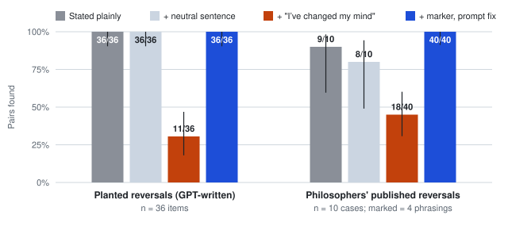
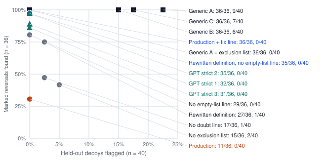
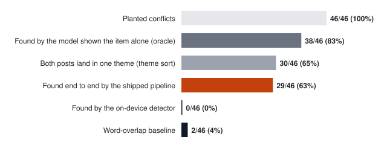
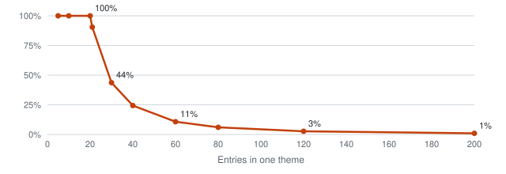

# Abstract
A tool that shows people where their views have changed can look safe while missing what it exists to find. We audited Persona, a tool we shipped that maps conflicts and changes of mind in a person's own writing, against changes of mind documented in public-domain texts: 12 development cases by ten authors, then two sets of six sourced later by agents not shown our prompts.

The shipped prompt raised no false alarms, yet given each whole history it found the change in 2 of 24 cases, and its word-overlap grouping never put a change's two ends together. The audit traced four causes: grouping by shared words a definition that counts only views asserted at once (on planted items one "I've changed my mind" cut detection from 36/36 to 9-17/36); a 400-character cut that hid the decisive sentence; and retractions that never restate the old view.

A repaired configuration (whole history in one call, two prompts merged, longer excerpts) found 17 of 18 cases on its tuning sets and 6 of 6 in every look on a third set sourced after it was deployed; there the shipped prompt found 1 but simpler prompts 5-6, so that set confirms the failure, not each repair. A prompt asking only for statements that cannot both be true found 7 of 24. Our first scorer, crediting only the keyed passage, reported 8 of 19 pairs where blind labels show 11 of 12 cases. Seventeen of 41 numeric predictions failed. User benefit is unmeasured.

# 1. Introduction

Track 3 asks whether AI tools lead people to decisions they later endorse. One candidate reads what a person has written over the years, finds where their views conflict or have changed, and asks where they stand now: the "reflection scaffolding" of Forethought's angels-on-the-shoulder sketches [1]. Done well, it surfaces drift people miss, including views picked up from an assistant that agreed with them [2, 3, 4]. Done badly, it nags about refinements, or silently drops the changes people would most want on record. The second failure is the dangerous one, because nothing shows it: a tool that flags nothing raises no complaints.

We audited one such tool that was already shipped. **Persona**, part of Amphi (amphi-forum.org), imports a person's posts, notes and AI-chat exports and sends excerpts to Claude Haiku 5.5, which returns pairs that become cards with one neutral question. Before this sprint it had never raised a false alarm in our checks. The product predates the sprint (Table 1); the sprint's work is the audit and the repairs. Contributions:

1. **A hidden failure, measured on real records.** On 24 documented changes of mind in three sets, the shipped prompt found 2 even when shown each whole history, with no false flags on controls, and the shipped grouping never placed the two ends of a change together.
2. **Its four causes**, each isolated: word grouping, the prompt's definition (by crossed ablations with a placebo on planted items; independently written strict prompts did not share it), a 400-character excerpt cut, and retraction-only announcements.
3. **A repair tested on records it was not tuned on.** Frozen and deployed before its test set existed, it found 6 of 6 changes (18 of 18 looks) where the shipped prompt found 1, with no control flagged. That set proved easy (simpler prompts found 5-6 of 6), so it confirms the failure; the need for each part of the repair rests on the tuning sets. A prompt in the style of document self-contradiction work found 7 of 24 cases, so the failure is not peculiar to our prompt.
4. **An audit method, including its own failure.** Answer keys from documented changes, blind labels calibrated on known pairs and decoys, predictions written before each run, and two later-sourced test sets. Our first scorer, crediting only the keyed passage, scored the best prompt at 8 of 19 pairs where it finds 11 of 12 cases; we report both scores, and every failed prediction (17 of 41).

**Table 1. Built before the sprint vs during it (Nov 13-15, 2026).**

| Before the sprint (shipped Nov 1) | During the sprint |
|---|---|
| Import of posts and AI chats; word-overlap theme sort; on-device detector; opt-in model step and its prompt (Haiku 5.5); conflict cards with verdicts | "Change of mind" vs live label; this whole evaluation (`evals/conflicts`, `paper/`). Deployed: Nov 14 afternoon, whole history in one call with realX (main c27f1622); Nov 14 evening, a second "changes" prompt merged in and excerpts up to 1,000 characters (main 34bfd61e). |

# 2. Related work

**Sycophancy and belief drift.** Assistants agree with users' stated views [2], affirm both sides of a moral conflict about 48% of the time [3], and leave people surer they are right while being preferred [4].

**Contradiction and belief change.** ContraDoc studies self-contradiction inside long documents [5]; BeliefShift benchmarks how assistants track a user's changing beliefs [6]; FactTrack gives facts validity intervals so change over time is not mistaken for error [7]; BeliefBank keeps a model's own beliefs consistent [8]; people prefer explanation-guided revision [9]; stance datasets follow opinion shifts on social media [15]. These model revision. We test a shipped tool end to end on real authors' documented reversals, and show that a deployed prompt's wording, its grouping step and its excerpt length can each put revision out of reach.

**Prompt and cue sensitivity.** Outputs shift with meaning-preserving formatting [12]; models often fall back on internal knowledge rather than supplied label definitions [13]; they mishandle negation [14]. Here the model followed its definition; the definition was the problem.

**Epistemic products.** Track 3's examples include a Crux Mapper for inconsistencies in group beliefs; Persona is the individual, longitudinal analogue. Reviewers of a winning Apart entry (LidaSim) asked for validation against real outcomes [11]. Our nearest substitute is writing by real people whose changes of mind are documented in their own words.

# 3. Methods

## 3.1 System under test

1. **Theme sort** (on device). TF-IDF terms per entry, grouped into themes by shared words.
2. **Model step** (opt-in). Per theme, up to 20 excerpts spread over time, each cut to 400 characters, go to Haiku with the production prompt (Appendix B). It has a **definition** ("Count a pair only when the person asserts both as their own view, on the same point, and they clash"), an **exclusion list** ("Do not count: ... questions, doubt ...; describing, quoting or answering someone else's view; ..."), an **empty-list default** ("Most themes have none, and an empty list is the right answer then") and output rules.
3. **Card**, labelled "change of mind" or "live" (label added Nov 13, during the sprint).

## 3.2 Answer keys

**Real writing (main).** Documented changes of mind in public-domain English texts (Gutenberg, Wikisource, archive.org), each with a secondary source, every passage checked by script to appear verbatim. Each case has an **early** passage stating the earlier view, a passage in a later, separate work where the author **announces** the change, a later **unannounced** statement of the new view where one exists, and an early-work **control**. Each case becomes a history: up to 60 paragraphs sampled from the early work and 60 from the later one, dated, plus the passages (72-124 posts). Three sets:
- *Development* (12 histories, 10 authors): Hume, Peirce, Nietzsche x3, Kant, Russell, Darwin, Newman, Mill, Spencer, Huxley. Six were the held-out set of earlier rounds.
- *Fresh set 1* (6), sourced by a separate agent with no access to prompts or results: Franklin, Romanes, Godwin, W. James, Freud, Gladstone. Used to diagnose the repairs, so not untouched.
- *Fresh set 2* (6), sourced by another agent after the final configuration was committed, pushed and deployed (17:24 ET; the cases were written at 17:38, the first run at 17:40): Lyell x2, Besant, Darwin (Glen Roy), Buckland, Sedgwick. Run once. Its agent was not shown our prompts, but its brief asked it to prefer passages near the start of their paragraph, because the shipped tool read only 400 characters; that selected against cause 3 (Section 4.2).

Whether each announced passage states the new view or only retracts ("I neither know how to correct my former opinions") was coded before any run (Appendix E).

**Planted items** (mechanism only). 24 GPT-written histories on five contested PhilPapers questions [10], 50 hand-written items, 10 philosophers' reversals paraphrased, and 40 items written after the prompt repairs were chosen; blind Sonnet labellers agreed with the intended labels on 149/150 and 40/40 (Table 2).

**Table 2. What counts.** Positives should be flagged; decoys and controls should not.

| Set | Positives | Decoys / controls |
|---|---|---|
| Planted, GPT-written (120) | plain, reworded, narrated change, buried (46) | someone else's view, doubt, question, refinement, shared word, hypothetical, restatement (74) |
| Hand-written (50); fresh GPT-written (40) | reported view later adopted, hedged reversal, double negation (28); narrated reversals (20) | sarcasm, concession, reaffirmation (22); narrated refinements, doubts (20) |
| Real writing (24 cases) | early + announced (24), early + unannounced (15) | early + control (24) |

## 3.3 Scoring

**Strict pairs** (earlier rounds): a run counts only if it returns the keyed early passage with the keyed later passage. **By change of mind** (case level): a run finds a case if it returns a keyed pair, or any pair with one side from the early work and one from the later work that two labellers, Haiku and Sonnet, each shown the case's question and the two passages and blind to which prompt produced them, both judge to reject or abandon the earlier view on that question. Over eight label rounds the labellers called 139 of 149 keyed pairs and 7 of 126 random early-by-later decoy pairs a match. A case is found when a majority of runs (or, for two-call configurations, of looks) find it. Controls flagged count against a configuration.

## 3.4 Runs and process

**Model and harness.** Haiku 5.5 through Claude Code subagents, one fresh agent per request; prompts passed verbatim, replies parsed by the production parser. Temperature cannot be set, so real-text arms ran 3-6 times (the production prompt on the fresh sets once). Each look of a two-call configuration pairs one run of each prompt. Development and fresh set 1 used the tested realX text; fresh set 2's deployed configuration used the deployed text, which adds the shipped output rules (a neutral question, at most 8 pairs); round 19's single-prompt arms used the tested texts.

**Prompts.** *Production*: the shipped prompt. *realX*: a generic "find contradictions" prompt with production's exclusion list, plus one paragraph saying a view the writer formerly held counts. *Changes*: asks first for each later excerpt where the writer turns against an earlier view of their own, even vaguely ("my former opinions") and without stating the new one, paired with the excerpt that states it, then for opposite sides a year or more apart. *Naive*: "Where does this person contradict themselves?" Full texts in Appendix B.

**Process.** Each design and its numeric predictions were written in `PLAN.md` before its outputs existed and, through round 17, committed before them (Appendix C); round 18's plan entries were committed together after its runs, so for that round the record is the deployed commit that froze the configuration before fresh set 2 existed. Choices between configurations followed a rule written before the candidates' runs: most cases on development plus fresh set 1, then fewer control flags, then lower cost. Statistics: Wilson intervals, exact McNemar tests, bootstraps over histories (Appendix D).

# 4. Results

## 4.1 The shipped tool finds almost none of the documented changes, silently

**Grouping.** The word-overlap theme sort put the early and later passage in one theme for 0 of 19 keyed pairs in the development histories. Authors do not reuse their words across decades ("acquainted" in Russell's 1912 view, "widely held" in his 1921 retraction): ranked by TF-IDF similarity to the early passage, the true later partner came a median 59% of the way down its history, and shared no content word with it for 8 of 19.

**The prompt, even with both ends present** (Figure 1). Given each whole history in one call, the production prompt found 1 of 12 development cases (majority of three runs), 0 of 6 and 1 of 6 in the fresh sets, returning 0.0-0.3 pairs per history on average. It flagged no control. Under the strict score it surfaced 0 of the 19 development pairs in each of three runs.

**Memory does not explain what is found.** Haiku named the author of 26 of 27 passages from the 13 earliest cases, but from author, years and question alone it stated the documented change for only 7 of the 13; four of realX's eight strict finds are in cases it could not recall.

## 4.2 Four causes

**1. Word grouping** (above): splitting a record into word themes separates a view from the one that replaced it. Model grouping by question recovers some of this when a record is too long for one call (Appendix D), but for records that fit, sending the whole history is simpler.

**2. The definition** (planted items, oracle setting). With the production prompt Haiku found every unsignalled planted reversal (36/36). Adding "I used to see this differently, but I've changed my mind." before the later post cut this to 11/36 (25 lost, 0 gained, exact McNemar p = 6×10⁻⁸; three runs gave 11, 9 and 17); a neutral sentence in the same place left it at 36/36; Sonnet dropped from 36 to 14. Crossed ablations (three runs per cell) trace the loss to the definition "asserts both as their own view" and the empty-list default: a time-anchored definition adds 16.7 [11.6, 21.9] marked reversals, dropping the default 14.0 [10.5, 17.7], a placebo rewording of the same length −2.3 [−5.8, 1.3]. Removing the exclusion list did not restore recall; it buys precision (Appendix D). The cliff belongs to this prompt, not to strict prompts in general: three strict prompts GPT wrote from a brief asking for few false alarms lost 0-4 of 36 when marked, and generic prompts lost none.

**3. The 400-character cut.** In fresh set 1 the decisive words sat past character 400: Godwin's announcement is cut before what he would modify (it stops at "Not that I see cause to make any change respecting the principle of justice"), and James's early passage at "The private minds do not agglomerat". At 400 characters realX and changes missed both on a majority of runs (realX 0 of 6 runs each; changes 1 and 0 of 4); a later stance-over-time prompt found Godwin in 3 of 3 but James in 0 of 3 (Section 4.3). With each post cut instead to min(1000, 120,000 / posts) characters, the changes prompt found Godwin in 4 of 4 runs and James in 3 of 4; realX found Godwin 6 of 6 but James 1 of 6.

**4. Retraction without restatement.** Hume's announcement ("I neither know how to correct my former opinions, nor how to render them consistent") names no view. realX never paired it with the bundle-theory passage it retracts (0 of 9 runs at either length); the changes prompt did in 2 of 3 runs at 400 characters, by linking it to other Treatise paragraphs on personal identity, but 0 of 4 at the longer length. It is the deployed fix's one miss in 24 cases.

## 4.3 The repair, on records it was not tuned on

**Table 3. Cases found** (case level; majority of runs, or of looks for two-call configurations; controls flagged per run or look). Development and fresh set 1 chose the configuration; fresh set 2 tested it once. Rows marked † ran after that test (round 19), on all three sets at 400 characters; they are our wording in the spirit of prior work [5, 6], with the shipped output format, not those papers' methods.

| Configuration | Calls | Development /12 | Fresh 1 /6 | Fresh 2 /6 | Controls |
|---|---|---|---|---|---|
| Production prompt, whole history | 1 | 1 | 0 | 1 | 0 |
| Naive prompt, whole history | 1 | 10 | – | 5 | 0.67, 0 |
| realX, whole history | 1 | 11 | 4 | 6 | 0 |
| Changes, whole history | 1 | 12 | 4 | 6 | 0.33, 0, 0 |
| † "Cannot both be true" (ContraDoc-style) | 1 | 3 | 2 | 2 | 0 |
| † Belief stance over time (BeliefShift-style) | 1 | 10 | 5 | 6 | 0 |
| realX, longer excerpts | 1 | 11 | 5 | – | 0 |
| Changes, longer excerpts, two calls | 2 | 11 | 6 | – | 0.5, 1.0 |
| **realX + changes, longer excerpts (deployed)** | 2 | 11 | 6 | **6 (18/18 looks)** | 0.25, 0.75, **0** |

By the pre-set rule, realX + changes (17 of 18) tied changes asked twice and won on fewer control flags; read closely, the flagged "controls" were real changes on other questions (Spencer's 1851 and 1891 views of women's political rights; Romanes on theism), so our controls are not clean. Frozen and deployed, the configuration then found all six fresh-set-2 changes in every look (5 of 5, against 1 of 5, counting the two Lyell cases, which share both works, as one); under the strict score it returned the keyed pair in 22 of 27 key-pair looks, against 1 of 9 for the production prompt. Persona caps a look at 8 pairs; applied here it drops two pairs and no case.

**What fresh set 2 does not show** (round 19, predictions written first). On fresh set 2, realX alone and changes alone each found 6 of 6 at 400 characters and the naive prompt 5 of 6, against the shipped prompt's 1. The set confirms that the shipped prompt, not the cases, is the problem, but it cannot separate the repaired configurations: five of its six changes are announced outright, and its brief favoured passages inside the first 400 characters (Section 3.2). Over all 24 cases the deployed configuration beat realX at 400 characters only on Godwin and James (23 vs 21; exact McNemar p = 0.5). The case for longer excerpts and a second prompt rests on the tuning sets (Godwin, James, Hume; Section 4.2). Two prompts modelled on prior work bracket the result. Asking only for statements that "cannot both be true", as in document self-contradiction [5], found 7 of 24 cases, near the shipped prompt: the strict definition, not our wording, is what fails. Asking how each belief's stance changed over time, as in belief-drift tracking [6], found 21 of 24 (Godwin in 3 of 3 runs, where realX and changes failed at 400 characters) and missed James, Hume and Spencer; we wrote it after the repair, so it is not independent of what we learned. Neither flagged a control.

## 4.4 The audit's own failure: what the scorer hid

Our scorer through round 17 credited a run only for the keyed later passage. Under it, the best single call (realX) found 8 of 19 development pairs (majority of three runs; 5-10 per run), and we wrote that the tool remained weak. Reading its outputs showed it often paired the early view with another later paragraph stating the same change (Newman's "the Church of Rome was the only true Church"), or the announcement with other early paragraphs (Franklin's pamphlet). Scored by change of mind with blind labels, the same replies find 11 of 12 cases. Within the same round, the strict scorer also led us to conclude, and then withdraw, that the changes prompt added nothing. Separately, 12 of 36 harness subagents in one round declined the task and replied in prose containing "ok", which our runner accepted until a missing-file check caught it. An answer key built from passages is necessary but not sufficient: a change of mind is expressed in many paragraphs, and the scorer must be checked against the outputs it scores.

# 5. Discussion and limitations

**What this means for epistemic products.** A tool meant to support decisions people later endorse failed on the cases closest to endorsement, changes of mind the author put in print, and the failure was silent: its false-flag rate was zero throughout. Three of its four causes were design choices that look reasonable in isolation (group by shared words; define a conflict strictly; cut excerpts short for cost). Only a test against records with known changes, run end to end, revealed them.

**What generalises.** The specific clauses do not. Three lessons do: (1) splitting a record that fits in one context window throws away the comparison the tool exists to make; (2) a prompt tuned for few false alarms can return nothing even when the pair is in view, so recall must be measured end to end on real records; (3) the audit itself needs auditing: score by the change, not by the passage you happened to key, calibrate labellers on known pairs and decoys, and keep a set the configuration has never seen.

**Not shown:** that people want these cards, or that seeing them improves their decisions. The deployed fix's effect on real users is unmeasured.

**Limitations** (full list in Appendix A). No users. 24 real cases, famous authors the model largely knows, English, 18th-20th-century prose; fresh set 2 cases mostly announce the new view outright (5 of 6) and proved easy (simple prompts found 5-6 of 6); three of its texts are OCR. Case-level credit rests on Claude labellers (calibrated, but not people). One model family, in an agent harness, run by the product's author. Histories of 72-124 posts; a person's years of writing are longer, where grouping, not one call, must work.

**Future work.** A consented study in which people import their own history, list the changes of mind they know they made, rate each card, and revisit verdicts a month later; long real records; a cross-family replication; human labels for the case-level score.

# 6. Conclusion

On documented changes of mind in real writing, Persona's shipped prompt found 2 of 24 even when shown each whole history, and its word grouping never put the two views together, while raising no false alarms. The causes were a word-based split, a strict definition, a 400-character cut and retractions that never restate the view. A repaired configuration found all six changes in a set sourced after it was frozen and deployed. Blind spots like these hide behind zero false alarms; real records with known changes of mind find them, provided the scorer is itself checked.

# Code and data

Everything is at https://github.com/28gugales-dev/persona-audit: the evaluation code (`evals/conflicts/`); the data, raw model replies, the real-text cases and a ledger tying every number to its file are in `paper/`. Source texts are public domain; each case lists its URLs, line spans and secondary source (`paper/data/realtext_cases*.json`, `reversals_sources.md`). The audited product files, as shipped on Nov 1 and as deployed on Nov 14, are under `product/`.

# References

1. Cotton-Barratt, O., Vaintrob, L., Sourbut, O., Hadshar, R. (2026). Design Sketches: Angels-on-the-Shoulder. Forethought. https://www.forethought.org/research/design-sketches-angels-on-the-shoulder
2. Sharma, M. et al. (2023). Towards Understanding Sycophancy in Language Models. arXiv:2310.13548.
3. Cheng, M. et al. (2025). ELEPHANT: Measuring and understanding social sycophancy in LLMs. arXiv:2505.13995.
4. Cheng, M. et al. (2025). Sycophantic AI Decreases Prosocial Intentions and Promotes Dependence. arXiv:2510.01395.
5. Li, J., Raheja, V., Kumar, D. (2024). ContraDoc: Understanding Self-Contradictions in Documents with Large Language Models. NAACL 2024. arXiv:2311.09182.
6. Myakala, P. K., Agrawal, M., Manche, R. (2026). BeliefShift: Benchmarking Temporal Belief Consistency and Opinion Drift in LLM Agents. arXiv:2603.23848.
7. Lyu, Z., Yang, K., Kong, L., Klein, D. (2024). FactTrack: Time-Aware World State Tracking in Story Outlines. arXiv:2407.16347.
8. Kassner, N. et al. (2021). BeliefBank. EMNLP 2021. arXiv:2109.14723.
9. Vasileiou, S. L., Rago, A., Martinez, M. V., Yeoh, W. (2025). How Do People Revise Inconsistent Beliefs? Examining Belief Revision in Humans with User Studies. arXiv:2506.09977.
10. Bourget, D., Chalmers, D. (2023). Philosophers on Philosophy: The 2020 PhilPapers Survey. Philosophers' Imprint 23(11). https://survey2020.philpeople.org (CC BY-NC).
11. Apart Research. LidaSim: Testing AI Policies With Persona-Based Simulations (project page and reviews). https://apartresearch.com/sprints/projects/lidasim-testing-ai-policies-with-personabased-simulations-o8x6
12. Sclar, M. et al. (2024). Quantifying Language Models' Sensitivity to Spurious Features in Prompt Design or: How I learned to start worrying about prompt formatting. ICLR 2024. arXiv:2310.11324.
13. Mohammadi, S. et al. (2025). Do LLMs Adhere to Label Definitions? Examining Their Receptivity to External Label Definitions. EMNLP 2025. arXiv:2509.02452.
14. García-Ferrero, I. et al. (2023). This is not a Dataset: A Large Negation Benchmark to Challenge Large Language Models. EMNLP 2023. arXiv:2310.15941.
15. Sakketou, F. et al. (2022). Investigating User Radicalization: A Novel Dataset for Identifying Fine-Grained Temporal Shifts in Opinion. LREC 2022. arXiv:2204.10190.

# Appendix A. Limitations and Dual-Use / Ethical Considerations

**Limitations, and how each would change the reading.**

1. **No user study.** We measure whether the tool surfaces changes of mind, not whether surfacing them helps people reach decisions they later endorse. The real-text sets stand in for a person's record and for endorsement: the authors endorsed their change in print, not our flag. If people do not want narrated changes shown, the fix is a regression for them.
   - *Protocol for next time:* consenting users list their known changes of mind before running, rate each card ("would I want this shown?", "is it fair?"), and are re-asked a month later.
2. **Synthetic and historical text.** GPT wrote the planted posts: short, English, about philosophy. The real-text sets are published 18th-20th-century prose by famous authors, sampled from books, not posts or chats; 24 histories, 6 of them never used to choose anything. A modern person's history is shorter per entry, noisier and mixed. The planted decoys are cleaner than real look-alikes, so the 0/96 false-flag rate is optimistic; real-text cards from the grouping-v2 pipeline were judged non-genuine in 7-9 of 25.
3. **One model family, in an agent harness.**
   - The production call uses the API with effort "medium" and a real system prompt. Here the prompt reached Haiku inside a subagent, as text.
   - A harness check with a different wrapper and production's effort setting reproduced the contrast (36/36 vs 15/36), but individual borderline items flip between runs (20/36 marked items agree), so the size of the effect in production is uncertain. The direction was consistent across all phrasings, sets and wrappers.
   - Sonnet 5.5 reproduced the drop and the repair, but it is the same family. A cross-family check was planned and cut when the free and subscription quotas for GLM and DeepSeek ran out. We did not use paid capacity.
4. **Contamination and small n.** Haiku named the author of 9 of the 10 paraphrased cases, and of 26 of the 27 passages from the first 13 real cases shown without names (it took Huxley's 1862 passage for Darwin). This should make the real reversals easier to find, so the production prompt's misses are not explained by it; the repairs' recall may be inflated by it. The held-out real comparisons rest on 6 cases; grouping v2 was tuned on the 6 development histories, and both of its held-out predictions narrowly failed (grouping v1's real-text prediction also failed; Appendix F). The whole-history comparison was added after our mock review asked for it, with three runs per history; its realX arm was predicted before each run (the first threshold equalled the naive baseline's already-seen score), and realX itself was tuned on development pairs shown alone, not on whole histories. Model grouping with the shipped prompt was not run on real text, so "neither fix alone" rests on the two cells we did run (word themes with any prompt; whole histories with the shipped prompt). Our real histories are 72-124 excerpts; a person's years of posts and chats are longer, which is where grouping, not the single call, has to work.
5. **The fix.**
   - The fix line was written by the author after seeing failures and frozen before held-out runs (commit times, Appendix C). Because it names the cue, its recovery on marked text is partly instruction-following.
   - The cue-free rewrite avoids this, but was chosen after the ablations, then tested on fresh items, the hand-written sets and end to end (Tables 4, 6).
   - The deployed configuration (realX + changes, longer excerpts) was chosen on development and fresh set 1 and tested once, on fresh set 2. Its effect on real users is unmeasured. On development and fresh set 1 it ran with the tested realX text; on fresh set 2 with the deployed text, which adds the shipped output rules (a neutral question, at most 8 pairs). The changes prompt was written by the author from failure analysis on development data. Round 19 found that realX alone, changes alone and a naive prompt also find 5-6 of 6 on fresh set 2, so that test shows the shipped prompt's failure, not that each part of the repair is needed.
6. **Scorer and labellers.** Case-level credit rests on two Claude labellers judging pairs against each case's question (keyed pairs 139/149, random decoys 7/126 called a match). They are calibrated, not human, and a decoy rate near 6% means a configuration returning many cross-era pairs could earn some credit by chance; ours returned 2-6 pairs per history. The strict score is reported beside it. Our controls were not clean: two flagged "controls" were real changes on other questions.
7. **Round 18's record.** Its plan entries were written before each run but committed together afterwards (commit c8fc24d9); the timestamped evidence for the final test is that the configuration was committed and pushed to main (72823441 / 34bfd61e, 17:24 ET) before fresh set 2 was written (17:38) or run (17:40). Fresh set 2 mostly announces the new view outright (5 of 6), its sourcing brief favoured passages within the first 400 characters of their paragraph, and three of its texts are OCR.
8. **Judge.** We corrected four of our own planted labels after the judge disagreed. We report the uncorrected κ (0.69), and the main neutrality claim rests on lean-vs-neutral agreement, which the correction does not affect.

**Dual-use and ethics.**
- **Profiling.** Mapping a person's inconsistencies is a profiling capability. Pointed at someone else, the same pipeline is a tool for opposition research, harassment ("you said the opposite in 2019"), or for targeting persuasion at beliefs that are already wavering. Persona's design limits this:
  - it imports only accounts the person connects;
  - the model step is opt-in, under a separate consent;
  - the default detector runs on device and sends nothing;
  - excerpts are aliased, and nothing is stored server-side;
  - a weekly allowance caps use.
  These controls reduce misuse but do not prevent someone from uploading another person's public posts.
- **Steering.** A reflection tool can steer while appearing to inform. We measured question neutrality (97%) for that reason. The kind label is a framing risk: labelling any pair a year apart a "change of mind" frames the newer view as growth before the person has said which they hold. This happened for 17 of the 36 unsignalled test positives, purely by date (a count that follows our chosen gaps).
- **Data used in this paper.** No personal data was used. Test text is synthetic, paraphrased from published philosophy, or quoted from public-domain texts (pre-1930 publications and translations, from Project Gutenberg, Wikisource and archive.org); PhilPapers figures are used as aggregates under CC BY-NC. We did not use classroom data or anyone's Reddit history. A planned consented study of friends' histories was not run.
- **Effect of the fix.** It surfaces more cards. More cards could mean more pressure on people to "resolve" views they are happy to hold loosely. Persona lets people mark a pair "not a conflict" or "both", and those choices should stay one tap away.

# Appendix B. Prompts and the one-line fix

**Production system prompt** (`apps/api/src/features/persona/conflicts.ts`, `CONFLICTS_SYSTEM`), with the fix line in bold:

> You read excerpts one person wrote over time on one theme. Find where two of their own claims cannot both stand. Count a pair only when the person asserts both as their own view, on the same point, and they clash. **A change of mind still counts: if a later excerpt asserts, as their current view, something that cannot stand with what an earlier excerpt asserted, include the pair even when they say they have changed their mind.** Do not count: different points or a change of subject; questions, doubt, or being less sure than before; one excerpt simply being more careful than the other; describing, quoting or answering someone else's view; jokes. Most themes have none, and an empty list is the right answer then. Return at most 3 pairs, the sharpest first. [...format and injection-defence instructions omitted; full text in the repository...]

**The rewrite** (Section 4.2) makes two edits. It replaces the sentence "Count a pair only when the person asserts both as their own view, on the same point, and they clash." with:

> Count a pair only when each excerpt, at the time it was written, stated the person's own view, on the same point, and the two clash.

and deletes "Most themes have none, and an empty list is the right answer then." The ablation "definition only" makes the first edit alone.

**Placebo definition** (Section 4.2), reworded to the rewrite's length but keeping the production meaning:

> Count a pair only when the person asserts both excerpts as their own view, about the very same point, and the two of them clash.

**Changes prompt** (deployed beside realX; `CHANGES_SYSTEM` in the same file):

> Below is everything one person has written, oldest first. Find where they changed their mind. 1. Find each later excerpt in which the writer turns against a view they held earlier: they call an earlier opinion of theirs wrong or mistaken, renounce, retract or regret it, say they have given it up or can no longer defend or correct it, or say they were once a follower of something they now oppose. Count it even when they do not say what they think now, and even when they refer to the old view only vaguely ("my former opinions", "the section on X", "what I wrote then"). 2. Pair each such excerpt with the earlier excerpt that states the view being given up, on the same question. If no earlier excerpt states it, leave it out. 3. Also pair two excerpts written at least a year apart that take opposite sides on the same question, even if the later one never mentions a change. Do not count: [production's exclusion list, with doubt counted only if the writer disowns a view they stated, and a view the writer says they once held counted as their own]. Return at most 8 pairs, the clearest first. [...output and injection-defence rules as deployed...]

**Thesis label prompt** (round 18, Haiku and Sonnet): each card gives the case's question, the earlier and the later passage; "yes" only if the later passage, speaking for the author, rejects, abandons, retracts or contradicts the earlier passage's view on that question. Full text in `paper/results/haiku_in/label__thesis.txt`.

**Naive baseline prompt:**

> Below is everything one person has written over the last few years, oldest first. [posts] Where does this person contradict themselves? List every pair of posts in which they hold views that cannot both be true.

**Generic contradiction prompts** (Section 4.2). Each was followed by the same JSON output instruction:

> A: Here are excerpts one person wrote over time. Find pairs of excerpts that contradict each other.
>
> B: You check a person's writing for inconsistencies. List pairs of their claims that are logically inconsistent with each other. Ignore pairs that are only on different topics.
>
> C: Which of these excerpts by one person contradict each other?

**Independently written strict prompts** (Section 4.2). Codex (GPT) was given this brief and asked for three prompts in different styles (terse, numbered checklist, careful analyst): a journaling app reads one person's dated excerpts on one theme and should show pairs where their own views conflict; false alarms annoy users, so do not flag doubt or uncertainty, questions, someone else's view, jokes, or a later excerpt that merely refines or qualifies an earlier one; return the same JSON with one neutral question. The brief does not mention changes of mind. The three prompts are stored verbatim in `paper/data/strict_prompts_gpt.json`. Two of them allow that a dated change may count.

**Sycophancy pilot (earlier in the sprint, not part of the main claims).** Claude Haiku, Sonnet and Opus, run as subagents, each stated each side of 60 contested claims in separate chats. They agreed with both sides in 1.7%, 3.3% and 5.0% of pairs. Persona's on-device stance reader agreed with an LLM judge at κ = 0.02, so the "your AI agreed both times" flag needs the model step, not the on-device reader.

# Appendix C. Reproducibility record

Each arm's design was committed before any of its outputs were written (commit times, ET, Nov 14, 2026):

| Commit | Time | Contents |
|---|---|---|
| b7478374 | 01:12:02 | Evaluation data, harness, and the frozen fix line; held-out outputs written from 01:12:33 |
| 0806cd7e | 01:19:38 | Stage 4 design: marker on all positives, three more phrasings, second hand-written set, held-out pipeline |
| 8bebec36 | 01:34:27 | Mechanism arms (neutral prefix, three ablations) with written predictions |
| d080008d | 01:44:11 | Definition rewrite arms and harness check with written predictions |
| c1768442 | 01:51:29 | Generic prompts (unmarked and marked) and marked decoys, with predictions |
| 27e2a576 | 01:56:21 | Generic prompts on held-out decoys, with prediction |
| eb441c20 | 02:07:16 | Fresh narrated set and spec, repairs on it and on the hand-written sets and end to end, generic prompt plus exclusion list, variance reruns, with predictions |
| bae1e53d | 02:30:29 | Placebo definition, definition-by-default runs, Sonnet arms and the extra-card audit, with predictions |
| b51afc32 | 02:45:56 | GPT-written strict prompts, and genX on the fresh, hand-written and reversal sets, with predictions |
| acd69f6f | 02:59:33 | Fresh-set repeat runs, with predictions |
| 5772fec9 | 12:53:19 | Real-text test (PLAN v11), before the passages were collected |
| 3588b8d4 | 13:08:32 | Real-text development cases, histories and requests, before any run |
| cee78eb2 | 13:13:17 | Model grouping (v12) with predictions, after its planted development run, before held-out or real runs |
| 3bc7caf0 | 13:18:34 | realX frozen after one development run; grouping v2 and held-out predictions (v13) |
| ab802c07 | 13:40:57 | Held-out real-text cases, coding and requests, before any held-out run |
| 44357d00 | 13:53:42 | Whole-history naive baseline, author probe and run 3 (v14), before any of their runs |
| 28a01cc9 | 13:57:59 | Whole history + realX prediction (v15), after the v14 results, before its run |
| b6d9298f | 14:04:21 | Runs 2-3 of both whole-history arms (v16), before either run |
| 65a2f2b9 | 14:22:18 | Production prompt on whole histories, closed-book probe, no-call analyses (v17), before any run |
| 72823441 | 17:24:29 | Final configuration in product code (realX + changes, longer excerpts); pushed to main as 34bfd61e and deployed before fresh set 2 was written (17:38) or run (17:40) |
| c8fc24d9 | 17:43:28 | Round 18 (v18-v18c) plan, data, replies and scores, committed after its runs (plan entries were written before each run, but not committed separately) |

Every number in this paper is listed with its source file in `paper/RESULTS.md`; scoring scripts are in `evals/conflicts/gen/`.

# Appendix D. Earlier rounds, paired tests and pipeline losses

**Earlier rounds, strict score.** The rounds before round 18 scored only keyed pairs; their results stand as measured and are kept here. In them, "development" means the first 7 cases (6 histories: Hume, Peirce, Nietzsche x2, Kant, Russell, plus Mill on wages without a history) and "held-out" the next 6 (Darwin, Newman, Mill on socialism, Spencer, Huxley, Nietzsche on pity); round 18 treats all 12 histories as development.

**Prompt repairs before the real-text rounds.** On the 40 fresh items, over three runs, the rewrite and genX found 8.0 [4.7, 11.3] and 9.0 [6.0, 12.0] more of the 20 narrated reversals than production and flagged no narrated look-alike. On real development pairs, though, every prompt stayed low (genX 5/21): real authors describe their old view abstractly ("a theory which I formerly held myself"), and genX's own exclusion of "describing someone else's view" catches it. realX adds one paragraph saying a view the writer formerly held counts. Frozen after one development run, it flagged 1 of 82 unseen look-alikes and found 20/20 fresh reversals. On the held-out real set, over three runs, realX found 14/18 and genX 10/18, against production's 3/18; counted by case (found on a majority of runs), 5, 4 and 1 of 6. Unannounced real reversals stayed hard for every prompt (held-out 1-3 of 9).

**Table 4. Prompts, shown items directly** (Haiku; ranges over runs). *Marked*: 36 planted reversals with the marker. *Decoys*: 40 held-out planted decoys. *Fresh*: 40 items written after the repairs were chosen. *Real*: early + announced pairs, earlier-round development (7 cases × 3 runs) and held-out (6 × 3); controls were never flagged (production and genX 0 of 39 tries, rewrite 0 of 21, realX 0 of 25). – = not run. Placebo (7-15 marked), GPT's strict prompts, ablations and Sonnet in Section 4.2 and Appendices D-F.

| Prompt | Marked /36 | Decoys /40 | Fresh narrated /20 | Fresh look-alikes /20 | Real dev /21 | Real held-out /18 |
|---|---|---|---|---|---|---|
| **Production** (shipped) | 9-17 | 0 | 8-14 | 0 | 3 | 3 |
| **Rewrite**: time-anchored definition, no default | 32-35 | 0 | 18-19 | 0 | 4 | – |
| Generic A: "find contradictions" | 36 | 9 | 20 | 6 | – | – |
| **genX**: generic A + production exclusion list | 36 | 0 | 19-20 | 0 | 5 | 10 |
| **realX**: genX + "a view the writer formerly held counts" | – | 0 | 20 | 0 | 4 of 7 (tuning) | 14 |

**The grouping** (Table 6). Model grouping kept 18 of 20 held-out planted conflicts in one group (word sort 11) and, end to end, raised recall from 9/20 to 16/20 with the production prompt (8 gained, 1 lost, p = 0.039) and 18/20 with genX (10-1, p = 0.012), flagging no decoy; every card sat on a planted reversal (53 cards for 18 reversals with genX, because a reversal also pairs with the posts restating its earlier view). On real text the first version failed (1 of 10 development pairs together): it left 46-92 groups per history, mostly of one to three posts. Version 2 groups by the issue a writer could change their mind on; tuned on the development set (4/10), it put 4 of 9 held-out pairs together and, with realX, surfaced 3 of 9 held-out reversals end to end (Darwin, Spencer, Nietzsche on pity), where word grouping surfaces none. It costs about one Haiku call per 30 posts.

**Table 5. Each announced reversal, strict score** (development cases, earlier rounds; runs that surfaced the early + announced pair; the shipped pipeline surfaced none). *New view*: the announced passage states the new view. Development realX: its one tuning run.

| Case (* held-out) | New view | Alone: prod. | Alone: realX | Whole: naive | Whole: realX | Group v2 + realX |
|---|---|---|---|---|---|---|
| Hume | no | 0/3 | 0/1 | 0/3 | 0/3 | – |
| Peirce | yes | 1/3 | 1/1 | 3/3 | 3/3 | – |
| Nietzsche (comfort) | no | 0/3 | 0/1 | 0/3 | 0/3 | – |
| Nietzsche (Wagner) | yes | 0/3 | 1/1 | 0/3 | 0/3 | – |
| Kant | no | 0/3 | 0/1 | 0/3 | 0/3 | – |
| Mill (wages) | yes | 2/3 | 1/1 | – | – | – |
| Russell | yes | 0/3 | 1/1 | 2/3 | 2/3 | – |
| Darwin* | yes | 3/3 | 3/3 | 3/3 | 3/3 | 1/1 |
| Newman* | no | 0/3 | 2/3 | 0/3 | 1/3 | 0/1 |
| Mill (socialism)* | no | 0/3 | 3/3 | 2/3 | 3/3 | 0/1 |
| Spencer* | yes | 0/3 | 3/3 | 2/3 | 2/3 | 1/1 |
| Huxley* | yes | 0/3 | 3/3 | 0/3 | 2/3 | 0/1 |
| Nietzsche (pity)* | no | 0/3 | 0/3 | 0/3 | 0/3 | 0/1 |

**Strict-score whole-history runs (rounds 14-17).** Our real histories fit in one call (72-124 excerpts, under 56,000 characters), so we sent each whole, three runs per prompt. Production surfaced 0 of 19, naive 7, 4 and 4, and realX 10, 7 and 5; naive flagged a control in 2 of 36 history-runs, realX in none. On a majority of runs, naive found 6/19 [0.15, 0.54] and realX 8/19 [0.23, 0.64] (held-out 3/9 and 4/9). Resampling histories, realX found 7.3 pairs per run [5.0, 9.7] and naive 5.0 [2.3, 7.7]; realX minus naive 2.3 [0.3, 4.7], although at the pair level realX gained 2 and lost 0 (exact p = 0.5). Gains were mostly on announced changes (realX 6/12 announced, 2/7 unannounced; naive 5, 1). So the split hides the pair, and the shipped prompt suppresses it even when visible; neither fix alone found anything in our runs. Grouping is for histories too long for one call: on planted data the naive single call fell from 25/26 on 26-post histories to 16/26, with 213 pairs returned, on one 312-post history (Appendix D).

**Cards on real text.** Grouping v2 with realX returned 25 cards over the six held-out histories, about four per history. Raters judged 16-18 of them a real change or tension in the author's own views (blind Sonnet 16, Haiku 18; Opus, not blind, 16), so 7-9 were not; some genuine ones lie outside our key. Agreement was modest (κ 0.34-0.74, over these and 9 earlier cards). The single calls' first-run cards were labelled by the same blind prompt: naive, Haiku 23 and Sonnet 24 of 34 cards genuine (held-out 13 and 12 of 17); realX, 23 and 25 of 27 (held-out 11 and 13 of 14). All labels are from Claude models, not people.

**What the shipped model step gets right.** Shown items directly, the production prompt flagged 0 of 96 synthetic decoys (74 GPT-written, 22 hand-written; 95% upper bound 3.8%) and no real-text control, and a GPT judge validated on hand labels (κ = 0.94) found 116 of 120 of its questions neutral. The failures are misses, not false alarms, which is why they stayed invisible.

**Table 6. End to end** (shipped request builder, one run). Planted: 12 held-out histories (t12-t23). Real: pairs in one group, and reversals surfaced, over the development (10 pairs) and held-out (9) sets; *whole history* sends all 72-124 excerpts of a history in one call, so every pair is together.

| Grouping + prompt | Planted positives /20 | Planted decoys /40 | Cards (planted) | Real pairs together (dev, held-out) | Real surfaced (dev, held-out) |
|---|---|---|---|---|---|
| Word sort + production (shipped) | 9 | 0 | 17 | 0/10, 0/9 | 0/10, 0/9 |
| Word sort + rewrite | 12 | 0 | 28 | 0/10, 0/9 | – |
| Model grouping + production | 16 | 0 | 37 | 1/10 (v1), – | – |
| Model grouping + genX | 18 | 0 | 53 | 1/10 (v1), – | – |
| Model grouping v2 + realX | – | – | – | 4/10, 4/9 | –, 3/9 |
| Whole history + production (one call; majority of 3 runs) | – | – | – | all | 0/10, 0/9 |
| Whole history + naive prompt (one call; majority of 3 runs) | – | – | – | all | 3/10, 3/9 |
| **Whole history + realX** (one call; majority of 3 runs) | – | – | – | all | **4/10, 4/9** |

**Table 7.** Each prompt variant (run 1 only; Table 4 uses all runs) against production on the same 36 marked planted items and 10 marked reversals: items gained and lost, exact McNemar p, and the Holm-adjusted p over the five ablations.

| Variant | Planted: gained-lost | p | Holm p | Reversals: gained-lost | p |
|---|---|---|---|---|---|
| No exclusion list | 11-7 | 0.48 | 0.48 | 2-2 | 1.0 |
| No doubt line | 9-3 | 0.15 | 0.29 | 1-0 | 1.0 |
| No empty-list default | 18-0 | 7.6×10⁻⁶ | 3.1×10⁻⁵ | 3-1 | 0.63 |
| Rewritten definition | 18-2 | 0.0004 | 0.0012 | 6-0 | 0.031 |
| Rewritten definition, no empty-list default | 24-0 | 1.2×10⁻⁷ | 6.0×10⁻⁷ | 6-0 | 0.031 |

**Other pipeline losses** (production prompt):
- The 60-character filter left 10 of 30 hand-written items with nothing to send.
- The 20-excerpt window covers 44% of a theme's entry pairs at 30 entries, 11% at 60 and 1% at 200 (Figure 6).
- The on-device detector found 0/46 planted conflicts and none of the ten reversals. It needs verdict words like "myth", while people state positions as propositions. On the hand-written set it found 2 of 18 positives (both double negations) and flagged 1 of 12 decoys.
- A naive whole-history prompt found 25/26 positives on 26-post histories where the pipeline found 20/26 (6 vs 1 discordant, p = 0.125). Over one merged 312-post history it found 16/26 and returned 213 pairs.

# Appendix E. Reversal cases, prompt variants and the neutrality judge

**Real-text cases.** Sourced by four Sonnet agents, in four batches, from a fixed brief (public domain, verbatim, the announced passage from a later, separate work where possible, a secondary source opened). Rejected candidates and reasons are in `paper/data/realtext_dropped*.json`. Weak points the agents flagged and we kept: three development and three held-out announced passages retract without stating the new view (coded before any run); the Peirce 1905, Kant 1770, Mill 1848 and Spencer texts are OCR; Mill's early passage is from Laughlin's 1884 abridgement; the held-out Nietzsche case is the weakest (his announced passage is about idealism in general).

**Table 8. Every real case, by change of mind** (runs or looks that found the case; case level, blind labels). *New view*: the announced passage states the new view. Shipped prompt, realX and changes: one whole-history call, 400 characters (fresh set 2's realX and changes runs are round 19, after the test). Deployed: realX + changes, longer excerpts, one look = one call of each.

| Case | Set | New view | Shipped prompt | realX | Changes | Deployed |
|---|---|---|---|---|---|---|
| Hume: personal identity (1739→1740) | Dev | no | 0/3 | 0/3 | 2/3 | 0/4 |
| Peirce: diamond hardness (1878→1905) | Dev | yes | 0/3 | 3/3 | 3/3 | 4/4 |
| Nietzsche: metaphysical comfort (1872→1886) | Dev | no | 2/3 | 3/3 | 3/3 | 4/4 |
| Nietzsche: wagner (1871→1888) | Dev | yes | 1/3 | 3/3 | 3/3 | 4/4 |
| Kant: sensible intellectual (1770→1783) | Dev | no | 1/3 | 2/3 | 2/3 | 4/4 |
| Russell: consciousness (1912→1921) | Dev | yes | 0/3 | 3/3 | 3/3 | 3/4 |
| Darwin: adaptive utility (1859→1871) | Dev | yes | 0/3 | 3/3 | 3/3 | 4/4 |
| Newman: rome corrupt (1837→1864) | Dev | no | 0/3 | 3/3 | 3/3 | 4/4 |
| Mill: socialism hostile (1848→1873) | Dev | no | 0/3 | 3/3 | 3/3 | 4/4 |
| Spencer: ethics foundation (1850→1891) | Dev | yes | 0/3 | 3/3 | 3/3 | 4/4 |
| Huxley: progressive modification (1862→1870) | Dev | yes | 0/3 | 3/3 | 3/3 | 4/4 |
| Nietzsche: saint pity (1874→1888) | Dev | no | 0/3 | 3/3 | 3/3 | 4/4 |
| Franklin: liberty necessity (1725→1771) | Fresh 1 | no | 0/1 | 6/6 | 4/4 | 4/4 |
| Romanes: theism evidence (1878→1893) | Fresh 1 | no | 0/1 | 6/6 | 4/4 | 4/4 |
| Godwin: private affections (1793→1799) | Fresh 1 | yes | 0/1 | 0/6 | 1/4 | 4/4 |
| James: compound consciousness (1890→1908) | Fresh 1 | yes | 0/1 | 0/6 | 0/4 | 4/4 |
| Freud: seduction aetiology (1896→1905) | Fresh 1 | yes | 0/1 | 6/6 | 4/4 | 4/4 |
| Gladstone: church establishment (1838→1868) | Fresh 1 | yes | 0/1 | 6/6 | 4/4 | 4/4 |
| Lyell: antiquity of man (1853→1863) | Fresh 2 | yes | 0/1 | 2/3 | 2/3 | 3/3 |
| Besant: materialism soul (1877→1893) | Fresh 2 | yes | 0/1 | 3/3 | 3/3 | 3/3 |
| Darwin: glen roy (1839→1876) | Fresh 2 | yes | 0/1 | 3/3 | 3/3 | 3/3 |
| Buckland: universal deluge (1823→1836) | Fresh 2 | yes | 1/1 | 3/3 | 2/3 | 3/3 |
| Sedgwick: diluvial theory (1825→1831) | Fresh 2 | yes | 0/1 | 3/3 | 3/3 | 3/3 |
| Lyell: species origin (1853→1863) | Fresh 2 | no | 0/1 | 3/3 | 3/3 | 3/3 |

**realX** (Section 3.4) is genX with this paragraph after its first line: "People rarely restate an old view in the same words. Also count a pair when a later excerpt rejects, abandons or corrects a view that an earlier excerpt states, even when the later one describes that view in general terms, refers back to the earlier writing instead of quoting it, or calls it a view the writer formerly held." and "(a view the writer says they once held is their own)" added to the someone-else exclusion. Model-grouping prompts are in `evals/conflicts/gen/group_prompts.json`.

**Self-reported reversals (paraphrased).**
- Kept by a fixed rule: the philosopher says in print that they changed their mind, the sentence was checked on an opened page, and two sources support it.
- The cases:
  - Wittgenstein (meaning);
  - Putnam (functionalism; realism);
  - Jackson (knowledge argument);
  - Ayer (verifiability);
  - Rawls (stability);
  - Nozick (minimal state);
  - Singer (preference utilitarianism);
  - Flew (atheism);
  - Russell (denoting).
- Each is a first-person paraphrase with names removed, dated 2016 and 2023.

**Prompt variants.** We tested the production prompt, the fix line (Appendix B), and five ablations:
- no exclusion list;
- no doubt line;
- no empty-list default;
- the definition rewritten to "each excerpt, at the time it was written, stated the person's own view";
- the rewrite plus no empty-list default.

Each ran on the marked planted items, the marked reversals, the natural narrations (P3) and the 40 held-out decoys. The three generic contradiction prompts (Appendix B) ran on the planted items, unmarked and marked, and the decoys; generic A also ran on the fresh set and, with the production exclusion list added, as genX.

**Example cards from the rewrite** (Haiku, first run; production missed all three):
- 2019 "I would take both boxes..."; later "I have come round to taking only the sealed box when the predictor has an excellent record. I used to insist on taking both..." → "Do you hold that you should take both boxes, or only the sealed box, when the predictor is excellent?"
- "I think numbers exist independently of us"; later "I no longer think numbers are things existing somewhere independently of us" → "Do you hold that numbers exist independently of us, or that they do not?"
- "...a belief is justified when it comes from a way of forming beliefs that usually gets things right"; later "I changed my mind about what ultimately supports a belief..." → "Do you think a belief is justified by a reliable method, or only by basic beliefs that do not borrow support from others?"

Each question is neutral, but it asks which view the person holds when they have already said. For narrated changes, a card that confirms ("You moved from X to Y; is that still where you stand?") may fit better than one that asks. That is a design question for the user study.

**Neutrality.**
- A GPT judge labels each tool-written question as neutral, leaning earlier, leaning later, or off target.
- On 30 hand-labelled real questions plus 12 planted leaning ones, lean-vs-neutral agreement was 41/42 (κ = 0.94).
- Four-label κ was 0.69, our primary figure. Four of our planted labels had the direction wrong; correcting them gives 0.90.

# LLM usage statement

Claude (Claude Code, Opus) planned, built and ran the evaluation harness and drafted this report under the author's direction:
- Claude subagents ran the literature and source checks, reviewed the plan, and critiqued the results.
- GPT (via Codex) wrote the synthetic test posts and served as the neutrality judge.
- Claude Sonnet relabelled items blind and, as four agents, sourced the real-text cases; Haiku and Sonnet labelled the real-text cards and, blind, the case-level pairs.
- Claude Haiku 5.5 is the system under test.

Every number in the report is tied to a result file in `paper/RESULTS.md`; numbers from before the real-text rounds were re-checked by separate reviewer agents (two full passes). The author is responsible for the content.

# Appendix F. Every arm and its prediction

Each row through round 16 was committed before its outputs existed (Appendix C); rounds 18 and 19's rows were written in `PLAN.md` before their runs and committed afterwards. Three rows had no numeric prediction, as marked, and one was untestable. Failed predictions are kept in the paper. Counts in the text take one prediction per row (41 rows with a numeric prediction; 17 failed: 4 of 16 on planted items, 13 of 25 on real text) and count a row as failed if any part of it failed.

| Round | Arm (Haiku unless stated) | Prediction | Outcome |
|---|---|---|---|
| Stage 4 | Marker on all 36 planted positives and three more phrasings (confirmatory; designed after the first reversal result) | Paired contrast, no numeric prediction | 36→11; 18/40 pooled |
| 1 | Neutral sentence | ≥ 33/36 and ≥ 8/10 | Held: 36, 8 |
| 1 | No exclusion list | ≥ 30/36, decoys above 0/40 | **Failed** on recall: 15; decoys 2/40 |
| 1 | No doubt line; no empty-list default | Partial recovery, order not predicted | 17; 29 |
| 2 | Definition only | ≥ 25/36, ≥ 6/10, ≤ 2/40 decoys | Held: 27, 8, 1 |
| 2 | Rewrite; harness check | Exploratory | 35; 15 marked under a second wrapper |
| 3 | Generic A, B, C marked; decoys | ≥ 30/36 in 2 of 3; ≥ 3/40 in 2 of 3 | Held: 36, 36, 36; 9, 6, 7 |
| 3 | Marker on decoys | ≤ 3/40 for both repairs | Held: 0, 0 |
| 4 | Fresh set, production | ≤ 10/20 | **Failed**: 14 |
| 4 | Fresh set, fix / rewrite / generic A | ≥ 16/20 each; look-alikes ≤ 3 (generic ≥ 4) | Held: 20, 18, 20; 0, 0, 0 (6) |
| 4 | Rewrite on hand-written sets; end to end | Hedged ≥ 12, decoys ≤ 2; ≥ 11/20, ≤ 2/40 | Held: 12, 0; 12, 0 |
| 4 | genX on planted and decoys | ≥ 30/36, ≤ 2/40 | Held: 36, 0 |
| 4 | Variance reruns | Production 8-18 per run; rewrite ≥ 30 | Held: 11, 9, 17; 35, 35, 32 |
| 5 | Placebo, with and without default | Within production's range; within 5 of no default | Held: 10.0; 24.7 vs 26.3 |
| 5 | Definition x default, 3 runs | All four effects positive; rewrite ≥ 30 | Held |
| 5 | Sonnet: plain, neutral, marked, rewrite, decoys | ≥ 32; within 3; ≤ 24; ≥ 30; ≤ 2/40 | Held: 36; 36; 14; 35; 0, 0 |
| 5 | Extra cards end to end | Non-conflict share within 15 points of production | Untestable: production had none; rewrite 4, all non-conflicts |
| 6 | GPT strict prompts | Plain ≥ 32; decoys ≤ 4/40; ≥ 1 loses ≥ 8 marked | **Failed** for 2 of 3 (36, 30, 31); held (0, 0, 0); **failed** (max loss 4) |
| 6 | genX on fresh, hand-written, reversals | ≥ 18, ≤ 2; ≥ 12, ≤ 2; ≥ 8/10 | Held: 19, 0; 12, 0; 9 |
| 7 | Fresh set, runs 2-3: production, rewrite, genX | Production 11-17 per run; rewrite ≥ 16, genX ≥ 17; look-alikes ≤ 2; gains' CIs exclude 0 | Production **failed** low: 14, 10, 8. Others held: 18, 19, 19; 19, 20, 20; 0 every run; +8.0 [4.7, 11.3], +9.0 [6.0, 12.0] |
| 10 (v11) | Real text, Test A: rewrite and genX on development announced pairs | ≥ 80% each; production ≤ 50%; failure if both < 60% | **Failed**: 4/21, 5/21 (production 3/21); failure condition met |
| 10 | Real text: unannounced vs announced, production | ≥ +30 points | **Failed**: 33% vs 14% |
| 10 | Real text: controls | ≤ 10% every arm | Held: 0/21 each |
| 10 | Real text: word sort, early and later in one theme | ≤ 70% | Held: 0/10 |
| 11 (v12) | Model grouping, held-out planted, together | ≥ 18/20 | Held: 18 |
| 11 | Model grouping, real development, together | ≥ 6/10 | **Failed**: 1/10 |
| 11 | Model grouping + genX end to end, held-out planted | ≥ 17/20, ≤ 2/40 | Held: 18, 0 |
| 12 (v13) | realX on unseen planted, fresh and hand-written sets | Decoys ≤ 2, ≤ 2, ≤ 2; fresh ≥ 18/20 | Held: 0, 0, 1; 20 |
| 12 | Held-out real, new-view cases: realX; genX | realX ≥ 60%; genX ≤ 40% | realX held (6/6 tries, runs 1-2); genX **failed** (5/6) |
| 12 | Held-out real: grouping v2 together; with realX surfaced | ≥ 50%; ≥ 40% | **Failed** narrowly: 4/9; 3/9 |
| 13 (v14) | Whole history in one call, naive prompt, real text | ≤ 4/19 surfaced; > 3 pairs per history | **Failed** both (it did better): 7/19; 2.8 |
| 13 | Author probe, real passages | ≥ 15 named correctly | Held: 26/27 |
| 13 | Held-out Test A, run 3 | Each arm within 1 of its mean of runs 1-2; controls 0 | Production, realX held (1 vs 1, 5 vs 4.5); genX **failed** (2 vs 4); controls 0 |
| 14 (v15) | Whole history + realX, real text | ≥ 7/19 surfaced (held-out ≥ 4/9), thresholds set at the naive baseline's already-seen scores; ≤ 2.8 pairs per history; controls in ≤ 1 history | Held: 10/19 (6/9); 2.3; 0 |
| 14 | Its cards, blind Haiku and Sonnet labels | Real share ≥ naive's (23/34, 24/34) | Held: 23/27, 25/27 |
| 16 (v17) | Whole history + production prompt, real text | 2-6 of 19 surfaced (majority of 3 runs) | **Failed**: 0 |
| 16 | Closed-book probe, 13 cases | Change and direction stated for ≥ 9 | **Failed**: 7 |
| 15 (v16) | Whole history, runs 2-3 | realX ≥ 8/19 in each; realX 3-run mean ≥ naive's + 1.5; realX controls in ≤ 1 history per run | **Failed**: 7, 5; held: 7.3 vs 5.0; held: 0 |
| 18 (v18) | Changes prompt, development (early-anchored scorer, 3 runs) | Changes alone ≥ 10/12; realX + changes ≥ 11/12 with Hume on a majority; controls ≤ 1 per run | **Failed**: 6; 11 but Hume 1/3; held |
| 18 | Fresh set 1: two realX runs merged vs one; production | Merged ≥ single + 1 case; controls ≤ 1; production ≤ 1 | Held: 3 vs 2; 0; 0 |
| 18 (v18b) | Longer excerpts, realX, fresh set 1 and development (case level) | Merged ≥ 5/6 fresh including Godwin and James; ≥ 11/12 dev; controls ≤ 1 per look; single long ≥ single 400 + 1 on fresh | **Failed** on James (5/6, James 1/6 runs); held: 11; 0; 5 vs 4 |
| 18 (v18c) | Final configuration, fresh set 2, one shot; production | Final ≥ 4/6; production ≤ 1; controls ≤ 1 history per look | Held: 6/6; 1; 0 |
| 19 | Fresh set 2 after the test: naive, realX, changes (400 characters) | ≥ 3, ≥ 4, ≥ 4 of 6; none above the deployed 6; controls ≤ 1 history per run | Held: 5, 6, 6; 0 |
| 19 | "Cannot both be true" prompt, 24 cases | Below realX on development and fresh set 1; controls ≤ 1 per run | Held: 3 vs 11, 2 vs 4; 0 |
| 19 | Belief-stance prompt, 24 cases | ≥ realX on development and fresh set 1; controls ≤ 1 per run | **Failed** on development (10 vs 11); held on fresh set 1 (5 vs 4); 0 |

The v12 prediction for model grouping + genX end to end on real text was not tested (version 1 was replaced before any real end-to-end run).

Exploratory comparisons beyond these rows (by-type breakdowns, item-level variance) are reported as descriptive only.
