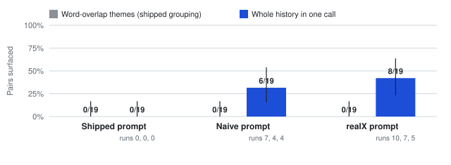

# Abstract

A tool that shows people where their views have changed can look safe while missing what it exists to find. We audited Persona, our shipped belief-mapping tool, against 30 changes of mind documented in the authors' published writing. Given each whole history, the shipped prompt found 3 of the 30 and flagged no control passage. The misses had four causes: grouping posts by shared words, a definition that counts only views held at the same time, 400-character excerpts, and retractions that never restate the old view. We rewrote the prompt and froze it before two new test sets were sourced; on their 12 changes it found 10, against 2 for the shipped prompt (p = 0.008). Persona now runs this rewrite with longer excerpts and one output line removed; on a fourth set, sourced after that version shipped, it found 6 of 7 against 1. Its edge over a one-line naive prompt is precision: 88% of its cards were judged genuine by two blind Claude labellers, against 50%. Checking a tool only for false alarms hides what it misses, and the scorer needs checking too: ours first hid most of the repair's effect. We report all 77 pre-written predictions, including the 37 that failed.

# 1. Introduction

Track 3 asks of epistemic products whether they surface the considerations that matter, and how one can tell. We ask it of a tool that surfaces changes in one person's own views. Such a tool reads what a person has written over the years, finds where their views conflict or have changed, and asks where they stand now: the "reflection scaffolding" of Forethought's angels-on-the-shoulder sketches [1]. Done well, it surfaces drift people miss, including views picked up from an assistant that agreed with them [2, 3, 4]. Done badly, it nags about refinements, or silently drops the changes people would most want on record. The second failure is the dangerous one, because nothing shows it: a tool that flags nothing raises no complaints.

We audited one such tool that was already shipped. **Persona**, part of Amphi (amphi-forum.org), imports a person's posts, notes and AI-chat exports. It sends excerpts to Claude Haiku 5.5, which returns pairs of passages that conflict; each pair becomes a card with one neutral question. Before this sprint it had never raised a false alarm in our checks. The product predates the sprint (Table 1); the sprint's work is the audit and the repairs. Our contributions:

1. **A silent failure, measured on real records.** Shown each whole history, the shipped prompt found 3 of 30 documented changes of mind and flagged none of the 30 control passages. In the development histories its word grouping never put the two ends of a change in the same batch (0 of 19). The same harness finds a reversal we planted in 29 of 30 of these histories, so the misses are the prompt's, not the test's.
2. **Four causes, each isolated** (Table 3): word grouping, the prompt's definition, a 400-character excerpt cut, and retractions that never restate the old view. Three strict prompts written independently by GPT to avoid false alarms found 1-6 of 30, so the failure is not peculiar to our wording.
3. **A repair tested on records it was not tuned on.** A rewritten prompt, frozen before two later test sets were sourced, found 10 of their 12 changes where the shipped prompt found 2. Persona now runs it with longer excerpts and one output line removed; that version found 11 of 12 against 1 on Sonnet, and 6 of 7 against 1 on a fourth set sourced after it shipped. Its main edge over a naive one-line prompt is precision.
4. **An audit method and a general lesson.** We had read a zero false-alarm rate as evidence that the tool was safe; it was the symptom. The method has five parts: answer keys from documented changes; blind labellers checked on decoy pairs; numeric predictions written before each run (37 of 77 failed); test sets sourced after deployment; and a check of the scorer itself. Our first scorer reported 8 of 19 keyed pairs for replies that in fact find 11 of the 12 development cases. Section 5 turns this into a five-step checklist.

**How to read the numbers.** A *case* is one documented change of mind. Its *keyed pair* is the author's early passage with the later passage announcing or stating the change; its *control* is an early passage on a view the author kept. A prompt *finds* a case when most of its runs return the keyed pair or another early-to-later pair that two blind Claude labellers (Haiku and Sonnet) judge a rejection of the earlier view (Section 3.3). A *card* is one returned pair, *genuine* when Sonnet and Opus both judge it a real change or tension in the author's own views.

- **Prompts.** *Shipped*: Persona's prompt before the sprint. *Rewrite*: our repaired prompt, frozen before the unseen sets, at 400 characters a post (the appendices call it *realX*). The *rewrite as deployed* adds longer excerpts and the shipped output rules; *Persona now* is that without the "at most 8 pairs" line, the prompt Persona runs today. *Naive*: a one-line "contradict themselves?" prompt.
- **Table columns.** *Tuning*: development and fresh set 1, used to choose the rewrite. *Unseen*: fresh sets 2 and 3, sourced after it was deployed. *Set 4*: sourced after Persona now shipped, run in a single round. *Controls*: how many of the 30 histories had their control flagged, averaged over runs. *Non-genuine*: cards per history on the first run (at most 8 counted) that Sonnet and Opus did not both judge real.

**One real card.** Persona now returned this pair from Nietzsche's history:

> **Earlier (dated 1871-05):** "…what hopes must revive in us when the most trustworthy auspices guarantee *the reverse process, the gradual awakening of the Dionysian spirit* in our modern world! … namely, *German music* as we have to understand it, especially in its vast solar orbit from Bach to Beethoven, from Beethoven to Wagner."
>
> **Later (dated 1888-01):** "…If in this essay I support the proposition that Wagner is *harmful*, I none the less wish to point out unto whom, in spite of all, he is indispensable—to the philosopher."
>
> **Question it wrote for the card:** "Do you hold that Wagner is an indispensable guide to the modern spirit, or that he is harmful?"
>
> **Labels:** genuine (Sonnet and Opus both said real; so did the author's blind check, Appendix A).

**Table 1. Built before the sprint vs during it (Nov 13-15, 2026).**

| Before the sprint (shipped Nov 1) | During the sprint |
|---|---|
| Import of posts and AI chats; word-overlap theme sort; on-device detector; opt-in model step and its prompt (Haiku 5.5); conflict cards with verdicts | The "change of mind" vs "live" card label; this whole evaluation (`evals/conflicts`, `paper/`); five product changes it led to, all deployed: (1) Nov 14, a short enough history goes to the model whole, with the rewritten prompt; (2) Nov 14, a second "changes" prompt added and excerpts lengthened to up to 1,000 characters; (3) Nov 15, the second prompt removed again; (4) Nov 15, the "at most 8 pairs" line removed; (5) Nov 15, the whole-history limit raised from 120 posts to 124 and then to 244. Commits: Appendix C. |

# 2. Related Work

**Sycophancy and belief drift.** Assistants agree with users' stated views [2], affirm both sides of a moral conflict about 48% of the time [3], and leave people surer they are right [4].

**Contradiction and belief change.** Prior work detects self-contradiction in long documents [5], tracks how a user's beliefs and stances shift [6, 15], keeps change over time from being read as error [7], and studies how models and people revise beliefs [8, 9]. We test a shipped tool end to end on real authors' documented reversals, and show that a prompt's wording, its grouping step and its excerpt length can each put revision out of reach.

**Prompt sensitivity.** Outputs shift with formatting [12]; models fall back on their own label meanings [13] and mishandle negation [14]. Here the model followed its definition; the definition was the problem.

**Epistemic products.** Track 3 lists a Crux Mapper for group beliefs; Persona is the individual, longitudinal analogue. Reviewers of a winning Apart entry (LidaSim) asked for validation against real outcomes [11]; documented changes of mind are our nearest substitute.

# 3. Methods

## 3.1 System under test

As shipped, Persona turns a person's dated posts (their **history**) into cards in three steps:

1. **Theme sort** (on device). Each post's distinctive words (TF-IDF terms) are found, and posts sharing words are grouped into themes.
2. **Model step** (opt-in). For each theme, up to 20 excerpts spread over time, each cut to 400 characters, go to Haiku with the shipped prompt (Appendix B). Its key parts are a **definition** ("Count a pair only when the person asserts both as their own view, on the same point, and they clash"), an **exclusion list** ("Do not count: ... questions, doubt ...; describing, quoting or answering someone else's view; ...") and an **empty-list default** ("Most themes have none, and an empty list is the right answer then").
3. **Card.** Each returned pair becomes a card, labelled "change of mind" or "live" (label added during the sprint).

Since Nov 14 a history under a size limit (now 244 posts and 244,000 characters; Table 1) skips the theme sort and goes to the model whole, in one call, each post cut to an equal share of the request (at most 1,000 characters). In our tests every prompt saw each whole history in one call unless we say otherwise; the theme sort is tested on its own (Section 4.1).

## 3.2 Answer keys

**Real writing (main).** Each **case** is a change of mind documented in public-domain English texts (Gutenberg, Wikisource, archive.org) and confirmed by a secondary source; every passage was checked by script to appear verbatim. A case has an **early** passage stating the earlier view; an **announcement**, in a later, separate work, where the author says they changed their mind; where one exists, an **unannounced** later passage that simply states the new view; and a **control**: an early-work passage on a view the author did not change. The early passage paired with the announcement or unannounced passage is the case's **keyed pair**. The key is a form of later endorsement: every change in it is one the author affirmed in print. Each case becomes a history of up to 60 paragraphs sampled from each of the two works, dated, plus these passages (72-124 posts). Five sets:

| Set | Cases | How sourced | Role |
|---|---|---|---|
| Development | 12 | earlier rounds; six were their held-out set | tuning |
| Fresh set 1 | 6 | a separate agent with no access to prompts or results | tuning |
| Fresh set 2 | 6 | another agent, after the rewrite was frozen and deployed (cases written 14 minutes after); one planned look at the deployed configuration, single prompts a round later | unseen test |
| Fresh set 3 | 6 | a third agent the next day, blind to how the tool reads text, asked for announcements that retract without restating the new view (5 of 6 do); a single round of three runs | unseen test |
| Fresh set 4 | 7 | a fourth agent after Persona now shipped, with no hint about how the tool reads and no constraint on retraction type; a single round of three runs | clean test of Persona now, reported apart from the 30 |

Authors by set are in Appendix E; each set's sourcing and commit order is in Appendix A (item 7). Whether each announcement states the new view or only retracts it was coded before any run (Appendix E), because cause 4 turns on it.

**Planted items** (to isolate causes, where the right answer is known). 24 GPT-written histories on five contested PhilPapers questions [10], 50 hand-written items, 10 philosophers' reversals paraphrased, and 40 items written after the prompt repairs were chosen. Blind Sonnet labellers agreed with the intended labels on 149 of 150 items checked and on all 40 later items (Table 2).

**Table 2. What counts.** Positives should be flagged; decoys and controls should not.

| Set | Positives | Decoys / controls |
|---|---|---|
| Planted, GPT-written (120) | plain, reworded, narrated change, buried (46) | someone else's view, doubt, question, refinement, shared word, hypothetical, restatement (74) |
| Hand-written (50); fresh GPT-written (40) | reported view later adopted, hedged reversal, double negation (28); narrated reversals (20) | sarcasm, concession, reaffirmation (22); narrated refinements, doubts (20) |
| Real writing (30 cases) | early + announced (30), early + unannounced (21) | early + control (30) |

## 3.3 Scoring

**Finding a case.** A run finds a case in either of two ways: it returns the keyed pair, or it returns another pair joining a passage from the early work to one from the later work, which two labellers (Haiku and Sonnet) both judge to reject or abandon the earlier view on the case's question. The labellers see only the question and the two passages, not which prompt produced them. The model's temperature cannot be set, so each prompt ran three or more times on real text, and a case counts as **found** when most runs find it. A flagged control counts against the prompt. Earlier rounds used a **strict** score that credited only the keyed pair; Section 4.4 explains why we replaced it.

**Checking the labellers.** They called 362 of 397 judgments of keyed pairs a match and only 10 of 240 random early-by-later decoy pairs (further checks in Appendix A). The main contrast does not depend on the labellers: crediting only the exact keyed pair, the shipped prompt finds 2 of 30, the naive prompt 11 and Persona now 15.

**Card quality.** Sonnet and Opus labelled every card from each prompt's first run as real or not (*genuine* when both say real); we report **non-genuine cards per history**, the false-alarm cost a user would see.

## 3.4 Runs and process

**Harness.** Haiku 5.5 ran through Claude Code subagents, one fresh agent per request, with prompts passed verbatim and replies parsed by Persona's own parser. Each experiment batch is a numbered **round**.

**Prompts compared** (full texts in Appendix B). *Shipped*: the prompt as shipped. *Rewrite*: a generic "find contradictions" prompt with the shipped exclusion list, plus one **retraction paragraph** saying that retractions and references back count, with a clause that a view the writer formerly held is their own. *Naive*: "Where does this person contradict themselves?" Some rounds also ran a second *changes* prompt beside the rewrite, which asks for each later passage where the writer turns against an earlier view of their own; Persona briefly ran the pair and then dropped the second prompt (Table 1). As deployed, the rewrite adds the shipped output rules (a neutral question, at most 8 pairs).

**Process.** Before each round we wrote its design and numeric predictions in `PLAN.md`, and committed them before any output existed (Appendix C), except for rounds 18-20 (Appendix A). We chose between configurations by a rule written before their runs: most cases on development plus fresh set 1, then fewer control flags, then lower cost. Statistics: Wilson intervals, exact McNemar tests on paired cases, and bootstraps over histories (Appendix D). Four things guard against tuning until it worked: the rewrite was frozen before fresh sets 2 and 3 existed; fresh set 4 was sourced after Persona now shipped and run once; configurations were chosen by rules written before their runs; and we report all 77 pre-written predictions, including the 37 that failed (Appendix F).

# 4. Results

## 4.1 The shipped tool finds almost none of the documented changes, silently

**Grouping.** The theme sort never put the two ends of a change in the same theme: 0 of 19 keyed pairs in the development histories. Authors do not reuse their words across decades ("acquainted" in Russell's 1912 view, "widely held" in his 1921 retraction). When we ranked every post by word similarity (TF-IDF) to the early passage, the true later passage sat a median 59% of the way down, and for 8 of 19 it shared no content word with the early passage.

**The prompt, even with both ends present** (Figure 1). Given each whole history in one call, so grouping played no part, the shipped prompt found 1 of 12 development cases and 0, 2 and 0 of 6 in fresh sets 1-3, returning 0.0-0.3 pairs per history on average. It flagged no control. The harness is not at fault: when we planted one reversal in each history, it returned the planted pair in 29 of 30 and still found only 1 documented change.

## 4.2 Four causes

**Table 3. Four causes, each isolated** (Haiku; real-text counts are cases found of 30, majority of three runs, whole history).

| Cause | What isolates it | Before → after |
|---|---|---|
| 1. Grouping by shared words | Keyed early and later passages in one theme (development) | 0 of 19 together; a whole history puts every pair in one call |
| 2. Strict definition, empty-list default | Real text: swap the definition, then also drop the default, in the shipped prompt. Planted items: marked with "I've changed my mind" | Real: 3 → 6 → 11 of 30. Planted: +16.7 and +14.0 of 36 marked items, placebo −2.3 |
| 3. 400-character cut | Godwin and James, whose decisive words sit past character 400 | rewrite: Godwin 0 → 6 of 6 runs, James 0 → 1 of 6; changes prompt 1 → 4 of 4, 0 → 3 of 4 |
| 4. Retractions that never restate the view | Add the rewrite's retraction paragraph to the shipped prompt | 3 → 19 of 30 (2 → 6 without the announcement) |

**1. Word grouping** (Section 4.1). For records too long for one call, grouping posts by question with the model recovers some of these pairs (Appendix D).

**2. The definition.** We planted 36 reversals with no announcement, and the shipped prompt found all 36. We then added one sentence before each later post: "I used to see this differently, but I've changed my mind." Now it found 11 of 36 (25 lost, none gained; exact McNemar p = 6×10⁻⁸). A neutral sentence in the same place left 36 of 36; on Sonnet the marker cut 36 to 14. So the prompt dropped changes exactly when the writer said they had changed their mind. Swapping prompt parts in every combination (three runs each) traced this to two of them: the definition "asserts both as their own view", which excludes a view the writer no longer holds, and the empty-list default. Of the 36 marked items, a definition anchored in time recovered 16.7 [11.6, 21.9] and dropping the default 14.0 [10.5, 17.7] (controls: Appendix D). On real text the retraction paragraph mattered more than the definition. With it, the shipped prompt found 19 of 30 and the shipped prompt with both parts swapped 21; the rewrite found 13 without it and 25 with it.

**3. The 400-character cut.** In fresh set 1 the decisive words came after character 400. Godwin's announcement is cut before he says what he would change (it stops at "Not that I see cause to make any change respecting the principle of justice"), and James's early passage stops mid-word at "The private minds do not agglomerat". Longer excerpts, then min(1,000, 120,000 ÷ posts) characters, recover Godwin for both prompts and James for the changes prompt (Table 3).

**4. Retraction without restatement.** Hume's announcement ("I neither know how to correct my former opinions, nor how to render them consistent") names no view, and every configuration Persona has run since the rewrite misses it (run counts in Appendix D). Told which passage is the retraction, Haiku named the earlier view it disowns for 11 of 14 retraction-only cases. So for most retractions the hard part is noticing the retraction, not linking it to the view it drops.

## 4.3 The repair, on records it was not tuned on

**Table 4. The repair against baselines** (Haiku; whole history in one call; columns as defined in Section 1). *No change*: non-genuine cards on 30 histories built from the early works alone. † first run after the unseen results were known. More rows: Tables 4b and 4c.

| Prompt | Tuning (18) | Unseen (12) | All (30) | Set 4 (7) | Controls | Non-genuine | No change |
|---|---|---|---|---|---|---|---|
| Shipped | 1 | 2 | **3** | 1 | 0 | 0.07 | 0.00 |
| † Shipped + retraction paragraph | 12 | 7 | 19 | – | 0 | 0.07 | – |
| Naive ("contradict themselves?") | 13 | 7 | 20 | – | 0.7 | 1.17 | 0.93 |
| Rewrite, 400 characters (frozen) | 15 | 10 | 25 | – | 0.33 | 0.47 | 0.30 |
| **† Persona now: longer, no "at most 8"** | 16 | 10 | **26** | **6** | 0.67 | **0.27** | 0.40 |

**On the unseen sets, the rewrite found 10 of 12 against 2.** Its text was frozen at 13:18 on Nov 14, before fresh sets 2 and 3 existed (Appendix C). It found 8 cases the shipped prompt missed and missed none the shipped prompt found (exact McNemar p = 0.008). The one planned look at set 2 tested the configuration deployed that evening, the rewrite beside the changes prompt with longer excerpts: 6 of 6. The rewrite alone ran on set 2 a round later and on set 3 in that set's first runs. The two-prompt configuration also found 10 of 12, so we removed the second prompt (Table 1).

**Robustness.** Three further checks on the 12 unseen cases, each predicted first:
- With author names and titles replaced and dates shifted to 2001, the rewrite as deployed found the same 10 and the shipped prompt none (p = 0.002).
- Counted by author, that version did better for 7 authors and worse for none (sign test p = 0.016).
- On Sonnet 5.5 instead of Haiku, Persona now found 11 of 12 and the shipped prompt 1 (p = 0.002).

**A clean test of Persona now.** On fresh set 4, sourced after it shipped and run in a single round, Persona now found 6 of 7 and the shipped prompt 1 (5 wins, no losses; p = 0.06). Across all 19 cases sourced after deployment it found 16 against 3, but sets 2 and 3 were in view when it was chosen, so only set 4 tests it cleanly.

**Reading, not remembering.** Persona now finds changes the model cannot recall. Given only author, years and question, Haiku could state 14 of the 30 changes from memory; Persona now found 14 of the other 16 (and 12 of the 14), the naive prompt 9 of the 16. With the announcement deleted from each history, Persona now still found 16 of 30.

**The edge over a naive prompt is precision.** In recall the gain is small: at 400 characters the rewrite found all 20 of the naive prompt's cases plus 5 more (exact McNemar p = 0.06). The difference is in the cards. 88% of the cards Persona now shows were judged genuine, against 50% for the naive prompt: 38 points higher [25, 51], and 0.90 fewer non-genuine cards per history [0.57, 1.23] (bootstrap over histories). The "changed their mind?" prompt matched the rewrite's recall (25) at 0.93 non-genuine cards per history, against 0.47 for the rewrite and 0.27 for Persona now (Tables 4, 4b). The author's blind labels of 20 of these cards agreed with the labellers on 18 (κ = 0.80; Appendix A). The shipped prompt is not a precise alternative but simply worse: with the retraction paragraph added, it keeps its 0.07 non-genuine cards per history and finds 19 cases instead of 3. The repair has a cost: the prompt Persona now runs finds 26 of the 30 changes where the shipped prompt found 3, and shows 0.27 non-genuine cards per history where the shipped prompt showed 0.07.

**One output line caused most false cards.** On writing with no documented change (each early work alone, redated over six years), the rewrite as deployed raised 1.10 false cards per history, more than any other prompt (Table 4b). The line "Return at most 8 pairs, the sharpest first" made the model fill the quota. Without it, Persona now found 26 cases with 0.27 non-genuine cards per history on real histories and 0.40 on no-change writing, so Persona dropped the line under a rule written before the test (more on false cards in Appendix D). Persona now's 0.67 control flags are one history: Spencer's control, flagged in 2 of 3 runs.

**Long records.** On the 30 histories extended to 166-244 posts, Persona now sent whole found 28 cases at 0.67 non-genuine cards per history, while the theme sort, which handles records over the limit, found only 2. So Persona sends records up to 244 posts whole, by a rule written after the first test (Appendix D).

## 4.4 The audit's own failure: what the scorer hid

Our first scorer, used through round 17, credited a run only when it returned the keyed later passage. Under it the rewrite found 8 of 19 development pairs, and we wrote that the tool remained weak. The outputs showed why: the rewrite often paired the early view with another later paragraph stating the same change (Newman's "the Church of Rome was the only true Church"), or the announcement with a different early paragraph (Franklin's pamphlet). Scored by change of mind with blind labels, the same replies find 11 of 12 cases. A change of mind is spread over many paragraphs, so the scorer must be checked against the outputs it scores.

# 5. Discussion and Limitations

**What this means for epistemic products.** A tool meant to help people see their own changes of mind missed the clearest ones, changes the authors put in print, and the failure was silent: it flagged no control passage in any run, which we had read as evidence of safety. Three of its four causes were reasonable-looking design choices (word grouping, a strict definition, short excerpts for cost). Only an end-to-end test on records with known changes revealed them. Any reflection tool tuned to avoid nagging will drift this way unless its misses are measured as carefully as its false alarms.

**What generalises: an audit checklist for builders.** The specific clauses do not generalise; these tests do, and each caught something here.
1. Check that both ends of a known change reach the model together: word themes joined 0 of 19 keyed pairs.
2. Plant a reversal with and without a sentence announcing it: our prompt went from 36 of 36 to 11 of 36.
3. Run a one-line naive prompt on real records beside yours: 20 of 30 against the shipped 3.
4. Read past the excerpt cut on every miss: Godwin's and James's decisive words sat after character 400.
5. Score by the change, not the passage you keyed, calibrate labellers on decoys, and keep a set the configuration has never seen: our first scorer reported 8 of 19 keyed pairs for replies in which blind labels find 11 of the 12 development cases.

### Limitations

We ran no user study, so we have not shown that these cards help people reach decisions they later endorse; that is Track 3's first question and our next study. The 30 cases, plus the 7 of set 4, are by famous authors, in English, 18th-20th-century prose. Case credit rests on Claude labellers, with one blind hand check of 20 cards by the author. We used one model family (Haiku; Sonnet on the unseen sets), run by the product's author. Records over 244 posts still take the word-theme path, so Section 4.1's failure still applies to them. The full list is in Appendix A.

### Future Work

Real records over 244 posts, a cross-family replication, human labels from people other than the author.

# 6. Conclusion

On documented changes of mind in real writing, Persona's shipped prompt found 3 of 30 even given each whole history, flagged no control passage, and its word grouping never put the two views together. A rewritten prompt, frozen before two later test sets existed, found 10 of their 12 changes with far fewer false cards than a naive prompt. With longer excerpts and one output line removed, it is what Persona now runs, on records up to 244 posts. Blind spots like these hide behind zero false alarms; real records with known changes of mind find them, provided the scorer is itself checked.

# Code and Data

- **Code repository**: https://github.com/28gugales-dev/persona-audit. The evaluation code is in `evals/conflicts/`; the audited product files, as shipped on Nov 1 (pre-existing) and after each deployed change through Nov 15, are under `product/`.
- **Data**: the same repository, under `paper/`: the data, every raw model reply, the real-text cases and a ledger tying every number to its file. Source texts are public domain; each case lists its URLs, line spans and secondary source (`paper/data/realtext_cases*.json`, `reversals_sources.md`).

# References

1. Cotton-Barratt, O., Vaintrob, L., Sourbut, O., Hadshar, R. (2026). Design Sketches: Angels-on-the-Shoulder. Forethought. https://www.forethought.org/research/design-sketches-angels-on-the-shoulder
2. Sharma, M. et al. (2023). Towards Understanding Sycophancy in Language Models. arXiv:2310.13548.
3. Cheng, M. et al. (2025). ELEPHANT: Measuring and understanding social sycophancy in LLMs. arXiv:2505.13995.
4. Cheng, M. et al. (2025). Sycophantic AI Decreases Prosocial Intentions and Promotes Dependence. arXiv:2510.01395.
5. Li, J., Raheja, V., Kumar, D. (2024). ContraDoc: Understanding Self-Contradictions in Documents with Large Language Models. NAACL 2024. arXiv:2311.09182.
6. Myakala, P. K., Agrawal, M., Manche, R. (2026). BeliefShift: Benchmarking Temporal Belief Consistency and Opinion Drift in LLM Agents. arXiv:2603.23848.
7. Lyu, Z., Yang, K., Kong, L., Klein, D. (2024). FactTrack: Time-Aware World State Tracking in Story Outlines. arXiv:2407.16347.
8. Kassner, N. et al. (2021). BeliefBank. EMNLP 2021. arXiv:2109.14723.
9. Vasileiou, S. L., Rago, A., Martinez, M. V., Yeoh, W. (2025). How Do People Revise Inconsistent Beliefs? Examining Belief Revision in Humans with User Studies. arXiv:2506.09977.
10. Bourget, D., Chalmers, D. (2023). Philosophers on Philosophy: The 2020 PhilPapers Survey. Philosophers' Imprint 23(11). https://survey2020.philpeople.org (CC BY-NC).
11. Apart Research. LidaSim: Testing AI Policies With Persona-Based Simulations (project page and reviews). https://apartresearch.com/sprints/projects/lidasim-testing-ai-policies-with-personabased-simulations-o8x6
12. Sclar, M. et al. (2024). Quantifying Language Models' Sensitivity to Spurious Features in Prompt Design or: How I learned to start worrying about prompt formatting. ICLR 2024. arXiv:2310.11324.
13. Mohammadi, S. et al. (2025). Do LLMs Adhere to Label Definitions? Examining Their Receptivity to External Label Definitions. EMNLP 2025. arXiv:2509.02452.
14. García-Ferrero, I. et al. (2023). This is not a Dataset: A Large Negation Benchmark to Challenge Large Language Models. EMNLP 2023. arXiv:2310.15941.
15. Sakketou, F. et al. (2022). Investigating User Radicalization: A Novel Dataset for Identifying Fine-Grained Temporal Shifts in Opinion. LREC 2022. arXiv:2204.10190.

# Appendix A. Limitations and Dual-Use / Ethical Considerations

**Limitations, and how each would change the reading.**

1. **No user study.** We measure whether the tool surfaces changes of mind, not whether surfacing them helps people reach decisions they later endorse. The real-text sets stand in for a person's record and for endorsement: the authors endorsed their change in print, not our flag. If people do not want narrated changes shown, the fix is a regression for them.
   - *Protocol for next time:* consenting users list their known changes of mind before running, rate each card ("would I want this shown?", "is it fair?"), and are re-asked a month later.
2. **Synthetic and historical text.** GPT wrote the planted posts: short, English, about philosophy. The real-text sets are published 18th-20th-century prose by famous authors, sampled from books, not posts or chats; 30 histories, 12 of them (fresh sets 2 and 3) never used to choose anything. A modern person's history is shorter per entry, noisier and mixed. The planted decoys are cleaner than real look-alikes, so the 0/96 false-flag rate is optimistic; real-text cards from the grouping-v2 pipeline were judged non-genuine in 7-9 of 25.
3. **One model family, in an agent harness.**
   - The production call uses the API with effort "medium" and a real system prompt. Here the prompt reached Haiku inside a subagent, as text.
   - A harness check with a different wrapper and production's effort setting reproduced the contrast (36/36 vs 15/36), but individual borderline items flip between runs (20/36 marked items agree), so the size of the effect in production is uncertain. The direction was consistent across all phrasings, sets and wrappers.
   - The harness agents had file access in a repository that holds the answer keys. None of 1,582 real-text replies mentions a key, case file or repository path, and no agent that wrote a scored reply opened a case file, answer key or label map; two dev-set replies of the changes prompt came from agents that first read the opening of `PLAN.md` (round 25).
   - Sonnet 5.5 reproduced the drop and the repair, but it is the same family. A cross-family check was planned and cut when the free and subscription quotas for GLM and DeepSeek ran out. We did not use paid capacity.
4. **Contamination and small n.** Haiku named the author of 9 of the 10 paraphrased cases, and of 26 of the 27 passages from the first 13 real cases shown without names (it took Huxley's 1862 passage for Darwin). Yet from author, years and question alone it stated the documented change for only 7 of those 13 cases, and four of the eight pairs realX found on the first 13 cases under the strict score are in cases it could not recall, so memory does not explain what is found; with author names, own-work titles and dates masked, the rewrite found the same 10 of 12 unseen cases (round 25), though the prose itself stays recognisable. This should make the real reversals easier to find, so the production prompt's misses are not explained by it; the repairs' recall may be inflated by it. The unseen-case comparisons rest on 12 cases (fresh sets 2 and 3), one of them easy; grouping v2 was tuned on the 6 development histories, and both of its held-out predictions narrowly failed (grouping v1's real-text prediction also failed; Appendix F). The whole-history comparison was added after our mock review asked for it, with three runs per history; its realX arm was predicted before each run (the first threshold equalled the naive baseline's already-seen score), and realX itself was tuned on development pairs shown alone, not on whole histories. Model grouping with the shipped prompt was not run on real text, so "neither fix alone" rests on the two cells we did run (word themes with any prompt; whole histories with the shipped prompt). Our real histories are 72-124 excerpts (166-244 in the gate test); a person's years of posts and chats can be longer still, and past 244 posts grouping, not the single call, has to work.
5. **The fix.**
   - The fix line was written by the author after seeing failures and frozen before held-out runs (commit times, Appendix C). Because it names the cue, its recovery on marked text is partly instruction-following.
   - The cue-free rewrite avoids this, but was chosen after the ablations, then tested on fresh items, the hand-written sets and end to end (Tables 5, 7).
   - The two-call configuration (realX + changes, longer excerpts; deployed Nov 14-15) was chosen on development and fresh set 1 and tested once, on fresh set 2. Its effect on real users is unmeasured. On development and fresh set 1 it ran with the tested realX text; on fresh set 2 with the deployed text, which adds the shipped output rules (a neutral question, at most 8 pairs). The changes prompt was written by the author from failure analysis on development data. Round 19 found that realX alone, changes alone and a naive prompt also find 5-6 of 6 on fresh set 2, so that test shows the shipped prompt's failure, not that each part of the repair is needed. After round 21 we removed the second prompt from the product (Nov 15, main c9a32b4c); Persona now runs realX with longer excerpts alone (26 of 30 cases here). On fresh set 3, sourced without that bias, the two-call configuration tied realX alone (4 of 6 each), as did changes alone and the stance prompt.
6. **Scorer and labellers.** Case-level credit rests on two Claude labellers judging pairs against each case's question (keyed pairs 362/397, random decoys 10/240, hard negatives 3/51 called a match; these are repeated judgments of 51 distinct keyed pairs, which drew 48, 44, 47 and 46 both-yes in four rounds). They are calibrated, not human, and a decoy rate near 5% means a configuration returning many cross-era pairs could earn some credit by chance; ours returned 2-6 pairs per history, and crediting only each run's first pair (round 32) leaves Persona now at 24 of 30, the naive prompt at 18, the shipped prompt at 3. The strict score is reported beside it. The card labels behind Section 4.3's precision figure were checked once by hand: the author labelled 20 cards from round 32 (10 both labellers called genuine, 10 not, seed 20261115) without seeing the labels, arm or author, and agreed with the both-genuine label on 18 (κ = 0.80; Sonnet alone 17, κ = 0.69; Opus alone 18, κ = 0.78), calling all 10 genuine cards real. One labeller who built the product is not an independent panel, and the case-level thesis labels were not checked by hand (`paper/human_check/`). Details of the labeller checks summarised in Section 3.3: 3 of 51 hard-negative pairs (a case's control passage against its later passages) were called a match; a stricter third judge, Opus 5.5, made to quote the rejecting words, confirmed 105 of the 116 credited pairs that were not keyed; pooled with round 31's looser batch, decoy pairs drew 15 of 270 matches; two of the 3 hard negatives called a match were announcements that disown the whole earlier book; Opus accepted only 42 of the 51 keyed pairs (round 26); and crediting any early-by-later pair that includes a keyed passage, with no labeller, the shipped, naive and current prompts find 4, 22 and 25 of 30 (an unpredicted check). Harness subagents sometimes declined the task yet replied "ok"; a check for missing output files caught each case, and those runs were redone. In the card-quality batches, 26 of 30 keyed pairs and 3 of 30 control pairs, mixed in as anchors, were judged real. Our controls were not clean: two flagged "controls" were real changes on other questions.
7. **Test sets and round 18's record.** Fresh set 1 was used to diagnose the repairs, so it is not untouched. Set 2's brief asked for passages near the start of their paragraph, which favoured the shipped 400-character cut (cause 3); fresh set 2 proved easy partly for that reason. Four set-4 texts are OCR scans, kept with their errors. Set 3's brief and predictions were committed before its cases existed; set 4's brief, predictions and cases before any run. Rounds 18-20's plans were committed after their runs; for those rounds the record is the commit that froze the configuration before fresh set 2 existed. Round 18's plan entries were written before each run but committed together afterwards (commit c8fc24d9); the timestamped evidence for the final test is that the configuration was committed and pushed to main (72823441 / 34bfd61e, 17:24 ET) before fresh set 2 was written (17:38) or run (17:40). Fresh set 2 mostly announces the new view outright (5 of 6), its sourcing brief favoured passages within the first 400 characters of their paragraph, and three of its texts are OCR. Fresh set 3's predictions (e083b001, 02:18 ET Nov 15) and cases (cc168613, 02:51) were committed before its first run; its Ruskin case pairs two volumes of one title, and its Miller and Wordsworth secondary sources are weak.
8. **Judge.** We corrected four of our own planted labels after the judge disagreed. We report the uncorrected κ (0.69), and the main neutrality claim rests on lean-vs-neutral agreement, which the correction does not affect.

**Dual-use and ethics.**
- **Profiling.** Mapping a person's inconsistencies is a profiling capability. Pointed at someone else, the same pipeline is a tool for opposition research, harassment ("you said the opposite in 2019"), or for targeting persuasion at beliefs that are already wavering. Persona's design limits this:
  - it imports only accounts the person connects;
  - the model step is opt-in, under a separate consent;
  - the default detector runs on device and sends nothing;
  - excerpts are aliased, and nothing is stored server-side;
  - a weekly allowance caps use.
  These controls reduce misuse but do not prevent someone from uploading another person's public posts.
- **Steering.** A reflection tool can steer while appearing to inform. We measured question neutrality (97%) for that reason. The kind label is a framing risk: labelling any pair a year apart a "change of mind" frames the newer view as growth before the person has said which they hold. This happened for 17 of the 36 unsignalled test positives, purely by date (a count that follows our chosen gaps).
- **Data used in this paper.** No personal data was used. Test text is synthetic, paraphrased from published philosophy, or quoted from public-domain texts (pre-1930 publications and translations, from Project Gutenberg, Wikisource and archive.org); PhilPapers figures are used as aggregates under CC BY-NC. We did not use classroom data or anyone's Reddit history. A planned consented study of friends' histories was not run.
- **Effect of the fix.** It surfaces more cards. More cards could mean more pressure on people to "resolve" views they are happy to hold loosely. Persona lets people mark a pair "not a conflict" or "both", and those choices should stay one tap away.

# Appendix B. Prompts and the one-line fix

**Production system prompt** (`apps/api/src/features/persona/conflicts.ts`, `CONFLICTS_SYSTEM`), as shipped; the fix line, shown in bold, was not in it and was tested as an added line:

> You read excerpts one person wrote over time on one theme. Find where two of their own claims cannot both stand. Count a pair only when the person asserts both as their own view, on the same point, and they clash. **A change of mind still counts: if a later excerpt asserts, as their current view, something that cannot stand with what an earlier excerpt asserted, include the pair even when they say they have changed their mind.** Do not count: different points or a change of subject; questions, doubt, or being less sure than before; one excerpt simply being more careful than the other; describing, quoting or answering someone else's view; jokes. Most themes have none, and an empty list is the right answer then. Return at most 3 pairs, the sharpest first. [...format and injection-defence instructions omitted; full text in the repository...]

**The rewrite** (Section 4.2) makes two edits. It replaces the sentence "Count a pair only when the person asserts both as their own view, on the same point, and they clash." with:

> Count a pair only when each excerpt, at the time it was written, stated the person's own view, on the same point, and the two clash.

and deletes "Most themes have none, and an empty list is the right answer then." The ablation "definition only" makes the first edit alone.

**Placebo definition** (Section 4.2), reworded to the rewrite's length but keeping the production meaning:

> Count a pair only when the person asserts both excerpts as their own view, about the very same point, and the two of them clash.

**Changes prompt** (deployed beside realX; `CHANGES_SYSTEM` in the same file):

> Below is everything one person has written, oldest first. Find where they changed their mind. 1. Find each later excerpt in which the writer turns against a view they held earlier: they call an earlier opinion of theirs wrong or mistaken, renounce, retract or regret it, say they have given it up or can no longer defend or correct it, or say they were once a follower of something they now oppose. Count it even when they do not say what they think now, and even when they refer to the old view only vaguely ("my former opinions", "the section on X", "what I wrote then"). 2. Pair each such excerpt with the earlier excerpt that states the view being given up, on the same question. If no earlier excerpt states it, leave it out. 3. Also pair two excerpts written at least a year apart that take opposite sides on the same question, even if the later one never mentions a change. Do not count: [production's exclusion list, with doubt counted only if the writer disowns a view they stated, and a view the writer says they once held counted as their own]. Return at most 8 pairs, the clearest first. [...output and injection-defence rules as deployed...]

**Thesis label prompt** (round 18, Haiku and Sonnet): each card gives the case's question, the earlier and the later passage; "yes" only if the later passage, speaking for the author, rejects, abandons, retracts or contradicts the earlier passage's view on that question. Full text in `paper/results/haiku_in/label__thesis.txt`.

**Naive baseline prompt:**

> Below is everything one person has written over the last few years, oldest first. [posts] Where does this person contradict themselves? List every pair of posts in which they hold views that cannot both be true.

**Generic contradiction prompts** (Section 4.2). Each was followed by the same JSON output instruction:

> A: Here are excerpts one person wrote over time. Find pairs of excerpts that contradict each other.
>
> B: You check a person's writing for inconsistencies. List pairs of their claims that are logically inconsistent with each other. Ignore pairs that are only on different topics.
>
> C: Which of these excerpts by one person contradict each other?

**Independently written strict prompts** (Section 4.2). Codex (GPT) was given this brief and asked for three prompts in different styles (terse, numbered checklist, careful analyst): a journaling app reads one person's dated excerpts on one theme and should show pairs where their own views conflict; false alarms annoy users, so do not flag doubt or uncertainty, questions, someone else's view, jokes, or a later excerpt that merely refines or qualifies an earlier one; return the same JSON with one neutral question. The brief does not mention changes of mind. The three prompts are stored verbatim in `paper/data/strict_prompts_gpt.json`. Two of them allow that a dated change may count.

**Sycophancy pilot (earlier in the sprint, not part of the main claims).** Claude Haiku, Sonnet and Opus, run as subagents, each stated each side of 60 contested claims in separate chats. They agreed with both sides in 1.7%, 3.3% and 5.0% of pairs. Persona's on-device stance reader agreed with an LLM judge at κ = 0.02, so the "your AI agreed both times" flag needs the model step, not the on-device reader.

# Appendix C. Reproducibility record

Each arm's design was committed before any of its outputs were written (commit times, ET, Nov 14, 2026):

| Commit | Time | Contents |
|---|---|---|
| b7478374 | 01:12:02 | Evaluation data, harness, and the frozen fix line; held-out outputs written from 01:12:33 |
| 0806cd7e | 01:19:38 | Stage 4 design: marker on all positives, three more phrasings, second hand-written set, held-out pipeline |
| 8bebec36 | 01:34:27 | Mechanism arms (neutral prefix, three ablations) with written predictions |
| d080008d | 01:44:11 | Definition rewrite arms and harness check with written predictions |
| c1768442 | 01:51:29 | Generic prompts (unmarked and marked) and marked decoys, with predictions |
| 27e2a576 | 01:56:21 | Generic prompts on held-out decoys, with prediction |
| eb441c20 | 02:07:16 | Fresh narrated set and spec, repairs on it and on the hand-written sets and end to end, generic prompt plus exclusion list, variance reruns, with predictions |
| bae1e53d | 02:30:29 | Placebo definition, definition-by-default runs, Sonnet arms and the extra-card audit, with predictions |
| b51afc32 | 02:45:56 | GPT-written strict prompts, and genX on the fresh, hand-written and reversal sets, with predictions |
| acd69f6f | 02:59:33 | Fresh-set repeat runs, with predictions |
| 5772fec9 | 12:53:19 | Real-text test (PLAN v11), before the passages were collected |
| 3588b8d4 | 13:08:32 | Real-text development cases, histories and requests, before any run |
| cee78eb2 | 13:13:17 | Model grouping (v12) with predictions, after its planted development run, before held-out or real runs |
| 3bc7caf0 | 13:18:34 | realX frozen after one development run; grouping v2 and held-out predictions (v13) |
| ab802c07 | 13:40:57 | Held-out real-text cases, coding and requests, before any held-out run |
| 44357d00 | 13:53:42 | Whole-history naive baseline, author probe and run 3 (v14), before any of their runs |
| 28a01cc9 | 13:57:59 | Whole history + realX prediction (v15), after the v14 results, before its run |
| b6d9298f | 14:04:21 | Runs 2-3 of both whole-history arms (v16), before either run |
| 65a2f2b9 | 14:22:18 | Production prompt on whole histories, closed-book probe, no-call analyses (v17), before any run |
| 72823441 | 17:24:29 | Final configuration in product code (realX + changes, longer excerpts); pushed to main as 34bfd61e and deployed before fresh set 2 was written (17:38) or run (17:40) |
| c8fc24d9 | 17:43:28 | Round 18 (v18-v18c) plan, data, replies and scores, committed after its runs (plan entries were written before each run, but not committed separately) |
| e083b001 | 02:18:52 (Nov 15) | Fresh set 3 plan, brief rule and predictions (v21), before its cases existed |
| cc168613 | 02:51:20 (Nov 15) | Fresh set 3 cases and histories, before any run |
| 6ad576bd | 12:00:08 (Nov 15) | Definition swap on real text and retraction-link probe (v22), before any request existed |
| e08fae03 | 12:16:22 (Nov 15) | GPT strict prompts on real text and the shipped configuration's card cost (v23), before any request existed |
| b8d1a401 | 12:30:15 (Nov 15) | What ships on the unseen sets, and the retraction paragraph crossed with the shipped prompt (v24), before any request existed |
| 133fb59f | 12:48:35 (Nov 15) | Masked unseen histories, naive prompt on fresh set 1, and three analyses of existing replies (v25), before any request or output existed |
| 2211dd97 | 12:55:43 (Nov 15) | Hard-negative calibration and the evidence-quoting third judge (v26), before any card or label existed |
| 33f11bfc | 13:04:31 (Nov 15) | Card cost of every main prompt, naive at longer excerpts, closed-book probe on the later sets and an author-level test (v27), before any request, card or label existed |
| eda4f6a0 | 13:16:12 (Nov 15) | No-change histories, the change-of-mind one-liner and the precision bootstrap (v28), before any request, card or label existed |
| 0b509794 | 13:26:20 (Nov 15) | The deployed prompt at 400 characters and a product decision rule (v29), before any request existed |
| fc3f3559 | 13:32:44 (Nov 15) | The deployed prompt without its "at most 8 pairs" line and a product decision rule (v30), before any request existed; shipped as main 2a5e359e |
| e8982646 | 13:52:12 (Nov 15) | Announcing post deleted from the input, with predictions (v31), before any request existed |
| d17c1fd6 | 14:04:18 (Nov 15) | One Sonnet + Opus relabel of every main prompt's cards and a matched card budget (v32), before any label file existed |
| be99564a | 14:07:30 (Nov 15) | Recall split by closed-book memory (v33), before the split was computed |
| 8c7c4779 | 14:08:36 (Nov 15) | Planted canary inside each real history, shipped prompt (v34), before any request existed |
| 669f2a3e | 14:15:33 (Nov 15) | Sonnet on the unseen cases, shipped vs Persona now (v35), before any request existed |
| 30d15c36 | 14:41:24 (Nov 15) | Two-work histories without the documented change (v36), before any request existed |
| beb18ad0 | 15:17:11 (Nov 15) | Fresh set 4 brief and predictions (v37), before any case existed |
| 347186f6 | 15:19:37 (Nov 15) | Quote-required prompt and its decision rule (v38), before any request existed |
| 41fe2702 | 15:47:58 (Nov 15) | Fresh set 4 cases (7), before any run |
| 087671fd | 15:56:08 (Nov 15) | Whole-history gate raised to the largest tested history (v39), before the product change; shipped as main cea9afd9 |
| fdeeca54 | 17:36:52 (Nov 15) | Long histories and the gate rule (v40), before any request existed |
| 0ae2e76f | 17:54:40 (Nov 15) | Round 40 result (keep 124) and the theme-path comparison rule (v41), written after round 40, before any v41 request existed; shipped as main b9e4feef |

**Product commits on main** for Table 1's five deployed changes: (1) c27f1622; (2) 34bfd61e; (3) c9a32b4c; (4) 2a5e359e; (5) cea9afd9, then b9e4feef.

Every number in this paper is listed with its source file in `paper/RESULTS.md`; scoring scripts are in `evals/conflicts/gen/`.

# Appendix D. Earlier rounds, paired tests and pipeline losses

**Run details.** A two-call configuration (the rewrite plus the changes prompt) is scored by **looks**: each look pairs one run of each prompt, and a case is found on a majority of looks. Development and fresh set 1 used the rewrite's tested text; fresh sets 2 and 3 ran the two-call configuration with the deployed text; round 19's single-prompt arms used the tested texts.

**Table 4b. The other rows of Table 4** (same columns and rules as Table 4; italics, an earlier Haiku + Sonnet batch; † first run after the unseen results were known).

| Prompt | Tuning (18) | Unseen (12) | All (30) | Set 4 (7) | Controls | Non-genuine | No change |
|---|---|---|---|---|---|---|---|
| † Three strict prompts by GPT | 1, 5, 1 | 0, 1, 0 | 1, 6, 1 | – | 0 | *0* | – |
| † Naive ("changed their mind?") | 15 | 10 | 25 | – | 0 | 0.93 | 0.67 |
| Rewrite as deployed (longer excerpts; alone from Nov 15) | 16 | 10 | 26 | – | 0 | *1.00* | *1.10* |

**Table 4c. Every whole-history configuration** (case level; majority of runs, or of looks for two-call configurations; controls flagged per run or look; where an arm ran in more than one round the latest runs are shown, so the shipped prompt's fresh set 2 is 2 of 6 here and 1 of 6 in round 18's runs). Development and fresh set 1 chose the configuration; fresh sets 2 and 3 tested it once each. Rows marked † ran after the set-2 test (rounds 19, 22-24) at 400 characters; on fresh sets 2 and 3 the realX row with longer excerpts is its own three runs (round 24). The two prior-work rows are our wording in the spirit of [5, 6], with the shipped output format, not those papers' methods.

| Configuration | Calls | Development /12 | Fresh 1 /6 | Fresh 2 /6 | Fresh 3 /6 | Controls |
|---|---|---|---|---|---|---|
| Production prompt, whole history | 1 | 1 | 0 | 2 | 0 | 0 |
| † Production, time-anchored definition | 1 | 2 | 2 | 1 | 1 | 0 |
| † Production, that and no empty-list default | 1 | 5 | 2 | 2 | 2 | 0 |
| Naive prompt, whole history | 1 | 10 | 3 | 5 | 2 | 0.67, 0, 0, 0.33 |
| † Naive, longer excerpts (3.1 cards, 1.73 not genuine per history) | 1 | 9 | 4 | 5 | 2 | 0.67 |
| realX, whole history | 1 | 11 | 4 | 6 | 4 | 0, 0, 0, 0.33 |
| Changes, whole history | 1 | 12 | 4 | 6 | 4 | 0.33, 0, 0, 0.33 |
| † "Cannot both be true" (ContraDoc-style) | 1 | 3 | 2 | 2 | – | 0 |
| † Belief stance over time (BeliefShift-style) | 1 | 10 | 5 | 6 | 4 | 0 |
| † Three strict prompts written by GPT for few false alarms | 1 | 0, 3, 1 | 1, 2, 0 | 0, 1, 0 | 0, 0, 0 | 0 |
| † Production + realX's retraction paragraph | 1 | 8 | 4 | 5 | 2 | 0 |
| † That, time-anchored, no empty-list default | 1 | 9 | 4 | 5 | 3 | 0 |
| † realX without that paragraph (genX) | 1 | 7 | 2 | 2 | 2 | 0, 0, 0, 0.33 |
| † realX as deployed, 400 characters (3.1 cards, 0.90 not genuine per history; 0.67 on no-change writing) | 1 | 11 | 4 | 6 | 5 | 0 |
| realX, longer excerpts (deployed Nov 15) | 1 | 11 | 5 | 6 | 4 | 0 |
| **† Persona now (no "at most 8")** | 1 | 10 | 6 | 6 | 4 | 0.67, 0, 0, 0 |
| Changes, longer excerpts, two calls | 2 | 11 | 6 | – | – | 0.5, 1.0 |
| realX + changes, longer excerpts (deployed Nov 14-15) | 2 | 11 | 6 | **6 (18/18 looks)** | **4 (12/18 looks)** | 0.25, 0.75, **0**, **0** |

By the pre-set rule, realX + changes (17 of 18) tied changes asked twice and won on fewer control flags, though those "controls" were real changes on other questions (Spencer on women's political rights; Romanes on theism). Frozen and deployed, it found all six fresh-set-2 changes in every look.

**Fresh set 2 does not separate the repairs** (round 19): realX, changes and the naive prompt found 5-6 of its 6, five of which are announced outright, and its brief favoured early passages (Section 3.2). Prompts modelled on prior work bracket the result (Table 4c): asking only for statements that "cannot both be true", as in document self-contradiction [5], found 7 of 24 cases, so the strict framing, not our wording, fails; asking how each belief's stance changed over time, as in belief-drift tracking [6], found 25 of 30 (written after the repair).

**Cause 2, controls** (Section 4.2). A placebo rewording of the definition, of the same length, changed the 36 marked items by −2.3 [−5.8, 1.3]. The drop is our prompt's own: three strict prompts GPT wrote for few false alarms lost only 0-4 of 36 when marked. The real-text failure is not: those same three found 1, 6 and 1 of 30 real cases.

**Cause 4, Hume and the linking probe** (Section 4.2). The rewrite never paired Hume's announcement with the bundle-theory passage it retracts (0 of 9 runs: 3 at 400 characters, 6 longer); the changes prompt did in 2 of 3 runs at 400 characters but 0 of 4 longer. To separate noticing a retraction from linking it, we told Haiku which passage is the retraction and asked what earlier view it disowns (14 retraction-only cases, longer excerpts, three runs). It named a matching early passage in its top three for 11, Wordsworth's included. Hume (1 of 3 runs), Kant (0 of 3) and Coleridge (1 of 3) fail even then.

**Verbatim quotes** (Section 4.3). We also tried requiring a verbatim quote on every card. On the change-removed histories it cut non-genuine cards to 0.47 per history, but it lost two cases (24 of 30; 9 of 12 unseen) and on real histories raised non-genuine cards to 0.30, against 0.17 for the current prompt in the same batch. So Persona kept its prompt.

**Long records** (Section 4.3). We extended the 30 histories to 166-244 posts. Sent whole at 1,000 characters a post, the current prompt found 28 cases (26 at the shorter length) but raised 0.67 non-genuine cards per history (0.20 when short). That passed our pre-set limit of 0.5, so at first we kept the 124-post limit. But the theme sort, which handles records over the limit, found only 2 cases with 0.87 non-genuine cards per history, because it sent the keyed early passage to the model in only 9 of 30. A rule written after that result, and reported as such, raised the limit to 244 posts.

**Section 4 details** (moved from the body).
- Section 3.1: the whole-history limit was first 120 posts, which 29 of our 37 test histories (123-124 posts) exceeded; we raised it to 124 so they fit, and after the long-record test to 244 posts.
- Section 4.1: under the strict score the shipped prompt returned 0 of the 19 development keyed pairs in each of three runs.
- Section 4.2: the shipped prompt with the retraction paragraph found 19 of 30 where we had predicted at most 12.
- Unseen sets: set 3 alone, 4 against 0, p = 0.125. Every prompt missed Coleridge, whose early view sits inside a political address, and Wordsworth, whose 1821 retraction names nothing.
- Sonnet run: a safety classifier blocked 4 of 72 runs, changing no case.
- Set 4: Persona now missed Murchison, whose retraction sits in a noisy two-column scan. Over all 19 cases sourced after deployment, 13 wins and no losses against the shipped prompt (p = 0.0002).
- Memory split: the naive prompt found 11 of the 14 changes Haiku could state. With the announcement deleted, Persona now found 5 of 12 unseen.
- Dropping "at most 8 pairs": Persona now lost Russell and gained James.
- Some false-card cost remains. On real histories with the documented change removed (a different test from Table 4's *No change* column), Persona now raised 0.60 non-genuine cards per history (naive 1.17) beside 0.97 genuine ones: with no clear change to report, it reaches for weaker pairs.
- Long records: 0.20 non-genuine cards per history on the short histories.

**With Opus also required** on off-key pairs (round 26; keys still credited), the rewrite at 400 characters finds 23 of 30 and what ships 10 of 12 unseen; the shipped prompt 3.

**Earlier rounds, strict score.** The rounds before round 18 scored only keyed pairs; their results stand as measured and are kept here. In them, "development" means the first 7 cases (6 histories: Hume, Peirce, Nietzsche x2, Kant, Russell, plus Mill on wages without a history) and "held-out" the next 6 (Darwin, Newman, Mill on socialism, Spencer, Huxley, Nietzsche on pity); round 18 treats all 12 histories as development.

**Prompt repairs before the real-text rounds.** On the 40 fresh items, over three runs, the rewrite and genX found 8.0 [4.7, 11.3] and 9.0 [6.0, 12.0] more of the 20 narrated reversals than production and flagged no narrated look-alike. On real development pairs, though, every prompt stayed low (genX 5/21): real authors describe their old view abstractly ("a theory which I formerly held myself"), and genX's own exclusion of "describing someone else's view" catches it. realX adds one paragraph saying a view the writer formerly held counts. Frozen after one development run, it flagged 1 of 82 unseen look-alikes and found 20/20 fresh reversals. On the held-out real set, over three runs, realX found 14/18 and genX 10/18, against production's 3/18; counted by case (found on a majority of runs), 5, 4 and 1 of 6. Unannounced real reversals stayed hard for every prompt (held-out 1-3 of 9).

**Table 5. Prompts, shown items directly** (Haiku; ranges over runs). *Marked*: 36 planted reversals with the marker. *Decoys*: 40 held-out planted decoys. *Fresh*: 40 items written after the repairs were chosen. *Real*: early + announced pairs, earlier-round development (7 cases × 3 runs) and held-out (6 × 3); controls were never flagged (production and genX 0 of 39 tries, rewrite 0 of 21, realX 0 of 25). – = not run. Placebo (7-15 marked), GPT's strict prompts, ablations and Sonnet in Section 4.2 and Appendices D-F.

| Prompt | Marked /36 | Decoys /40 | Fresh narrated /20 | Fresh look-alikes /20 | Real dev /21 | Real held-out /18 |
|---|---|---|---|---|---|---|
| **Production** (shipped) | 9-17 | 0 | 8-14 | 0 | 3 | 3 |
| **Rewrite**: time-anchored definition, no default | 32-35 | 0 | 18-19 | 0 | 4 | – |
| Generic A: "find contradictions" | 36 | 9 | 20 | 6 | – | – |
| **genX**: generic A + production exclusion list | 36 | 0 | 19-20 | 0 | 5 | 10 |
| **realX**: genX + "a view the writer formerly held counts" | – | 0 | 20 | 0 | 4 of 7 (tuning) | 14 |

**The grouping** (Table 7). Model grouping kept 18 of 20 held-out planted conflicts in one group (word sort 11) and, end to end, raised recall from 9/20 to 16/20 with the production prompt (8 gained, 1 lost, p = 0.039) and 18/20 with genX (10-1, p = 0.012), flagging no decoy; every card sat on a planted reversal (53 cards for 18 reversals with genX, because a reversal also pairs with the posts restating its earlier view). On real text the first version failed (1 of 10 development pairs together): it left 46-92 groups per history, mostly of one to three posts. Version 2 groups by the issue a writer could change their mind on; tuned on the development set (4/10), it put 4 of 9 held-out pairs together and, with realX, surfaced 3 of 9 held-out reversals end to end (Darwin, Spencer, Nietzsche on pity), where word grouping surfaces none. It costs about one Haiku call per 30 posts.

**Table 6. Each announced reversal, strict score** (development cases, earlier rounds; runs that surfaced the early + announced pair; the shipped pipeline surfaced none). *New view*: the announced passage states the new view. Development realX: its one tuning run.

| Case (* held-out) | New view | Alone: prod. | Alone: realX | Whole: naive | Whole: realX | Group v2 + realX |
|---|---|---|---|---|---|---|
| Hume | no | 0/3 | 0/1 | 0/3 | 0/3 | – |
| Peirce | yes | 1/3 | 1/1 | 3/3 | 3/3 | – |
| Nietzsche (comfort) | no | 0/3 | 0/1 | 0/3 | 0/3 | – |
| Nietzsche (Wagner) | yes | 0/3 | 1/1 | 0/3 | 0/3 | – |
| Kant | no | 0/3 | 0/1 | 0/3 | 0/3 | – |
| Mill (wages) | yes | 2/3 | 1/1 | – | – | – |
| Russell | yes | 0/3 | 1/1 | 2/3 | 2/3 | – |
| Darwin* | yes | 3/3 | 3/3 | 3/3 | 3/3 | 1/1 |
| Newman* | no | 0/3 | 2/3 | 0/3 | 1/3 | 0/1 |
| Mill (socialism)* | no | 0/3 | 3/3 | 2/3 | 3/3 | 0/1 |
| Spencer* | yes | 0/3 | 3/3 | 2/3 | 2/3 | 1/1 |
| Huxley* | yes | 0/3 | 3/3 | 0/3 | 2/3 | 0/1 |
| Nietzsche (pity)* | no | 0/3 | 0/3 | 0/3 | 0/3 | 0/1 |

**Strict-score whole-history runs (rounds 14-17).** Our real histories fit in one call (72-124 excerpts, under 56,000 characters), so we sent each whole, three runs per prompt. Production surfaced 0 of 19, naive 7, 4 and 4, and realX 10, 7 and 5; naive flagged a control in 2 of 36 history-runs, realX in none. On a majority of runs, naive found 6/19 [0.15, 0.54] and realX 8/19 [0.23, 0.64] (held-out 3/9 and 4/9). Resampling histories, realX found 7.3 pairs per run [5.0, 9.7] and naive 5.0 [2.3, 7.7]; realX minus naive 2.3 [0.3, 4.7], although at the pair level realX gained 2 and lost 0 (exact p = 0.5). Gains were mostly on announced changes (realX 6/12 announced, 2/7 unannounced; naive 5, 1). So the split hides the pair, and the shipped prompt suppresses it even when visible; neither fix alone found anything in our runs. Grouping is for histories too long for one call: on planted data the naive single call fell from 25/26 on 26-post histories to 16/26, with 213 pairs returned, on one 312-post history (Appendix D).

**Cards on real text.** Grouping v2 with realX returned 25 cards over the six held-out histories, about four per history. Raters judged 16-18 of them a real change or tension in the author's own views (blind Sonnet 16, Haiku 18; Opus, not blind, 16), so 7-9 were not; some genuine ones lie outside our key. Agreement was modest (κ 0.34-0.74, over these and 9 earlier cards). The single calls' first-run cards were labelled by the same blind prompt: naive, Haiku 23 and Sonnet 24 of 34 cards genuine (held-out 13 and 12 of 17); realX, 23 and 25 of 27 (held-out 11 and 13 of 14). All labels are from Claude models, not people.

**What the shipped model step gets right.** Shown items directly, the production prompt flagged 0 of 96 synthetic decoys (74 GPT-written, 22 hand-written; 95% upper bound 3.8%) and no real-text control, and a GPT judge validated on hand labels (κ = 0.94) found 116 of 120 of its questions neutral. The failures are misses, not false alarms, which is why they stayed invisible.

**Table 7. End to end** (shipped request builder, one run). Planted: 12 held-out histories (t12-t23). Real: pairs in one group, and reversals surfaced, over the development (10 pairs) and held-out (9) sets; *whole history* sends all 72-124 excerpts of a history in one call, so every pair is together.

| Grouping + prompt | Planted positives /20 | Planted decoys /40 | Cards (planted) | Real pairs together (dev, held-out) | Real surfaced (dev, held-out) |
|---|---|---|---|---|---|
| Word sort + production (shipped) | 9 | 0 | 17 | 0/10, 0/9 | 0/10, 0/9 |
| Word sort + rewrite | 12 | 0 | 28 | 0/10, 0/9 | – |
| Model grouping + production | 16 | 0 | 37 | 1/10 (v1), – | – |
| Model grouping + genX | 18 | 0 | 53 | 1/10 (v1), – | – |
| Model grouping v2 + realX | – | – | – | 4/10, 4/9 | –, 3/9 |
| Whole history + production (one call; majority of 3 runs) | – | – | – | all | 0/10, 0/9 |
| Whole history + naive prompt (one call; majority of 3 runs) | – | – | – | all | 3/10, 3/9 |
| **Whole history + realX** (one call; majority of 3 runs) | – | – | – | all | **4/10, 4/9** |

**Table 8.** Each prompt variant (run 1 only; Table 5 uses all runs) against production on the same 36 marked planted items and 10 marked reversals: items gained and lost, exact McNemar p, and the Holm-adjusted p over the five ablations.

| Variant | Planted: gained-lost | p | Holm p | Reversals: gained-lost | p |
|---|---|---|---|---|---|
| No exclusion list | 11-7 | 0.48 | 0.48 | 2-2 | 1.0 |
| No doubt line | 9-3 | 0.15 | 0.29 | 1-0 | 1.0 |
| No empty-list default | 18-0 | 7.6×10⁻⁶ | 3.1×10⁻⁵ | 3-1 | 0.63 |
| Rewritten definition | 18-2 | 0.0004 | 0.0012 | 6-0 | 0.031 |
| Rewritten definition, no empty-list default | 24-0 | 1.2×10⁻⁷ | 6.0×10⁻⁷ | 6-0 | 0.031 |

**Other pipeline losses** (production prompt):
- The 60-character filter left 10 of 30 hand-written items with nothing to send.
- The 20-excerpt window covers 44% of a theme's entry pairs at 30 entries, 11% at 60 and 1% at 200 (Figure 6).
- The on-device detector found 0/46 planted conflicts and none of the ten reversals. It needs verdict words like "myth", while people state positions as propositions. On the hand-written set it found 2 of 18 positives (both double negations) and flagged 1 of 12 decoys.
- A naive whole-history prompt found 25/26 positives on 26-post histories where the pipeline found 20/26 (6 vs 1 discordant, p = 0.125). Over one merged 312-post history it found 16/26 and returned 213 pairs.

# Appendix E. Reversal cases, prompt variants and the neutrality judge

**Authors by set** (Section 3.2). development, Hume, Peirce, Nietzsche (3), Kant, Russell, Darwin, Newman, Mill, Spencer, Huxley; set 1, Franklin, Romanes, Godwin, W. James, Freud, Gladstone; set 2, Lyell (2), Besant, Darwin (Glen Roy), Buckland, Sedgwick; set 3, Newton (slave trade), Coleridge (Unitarianism), Miller (the days of Genesis), Ruskin (Rubens), Frazer (totems), Wordsworth (representation); set 4, Johnson (fixing the language), Weismann (unicellular variability; two volumes of one title, six years apart), Wilde (pain and pleasure), Jane Harrison (primitive religion), Schliemann (the burnt city at Troy), Martineau (a future life), Murchison (the Tilestones).

**Real-text cases.** Sourced by four Sonnet agents, in four batches, from a fixed brief (public domain, verbatim, the announced passage from a later, separate work where possible, a secondary source opened). Rejected candidates and reasons are in `paper/data/realtext_dropped*.json`. Weak points the agents flagged and we kept: three development and three held-out announced passages retract without stating the new view (coded before any run); the Peirce 1905, Kant 1770, Mill 1848 and Spencer texts are OCR; Mill's early passage is from Laughlin's 1884 abridgement; the held-out Nietzsche case is the weakest (his announced passage is about idealism in general).

**Table 9. Every real case, by change of mind** (runs or looks that found the case; case level, blind labels). *New view*: the announced passage states the new view. Shipped prompt (three runs on every set), realX and changes: one whole-history call, 400 characters (fresh set 2's realX and changes runs are round 19, after the test). Deployed: realX + changes, longer excerpts, one look = one call of each.

| Case | Set | New view | Shipped prompt | realX | Changes | Deployed |
|---|---|---|---|---|---|---|
| Hume: personal identity (1739→1740) | Dev | no | 0/3 | 0/3 | 2/3 | 0/4 |
| Peirce: diamond hardness (1878→1905) | Dev | yes | 0/3 | 3/3 | 3/3 | 4/4 |
| Nietzsche: metaphysical comfort (1872→1886) | Dev | no | 2/3 | 3/3 | 3/3 | 4/4 |
| Nietzsche: wagner (1871→1888) | Dev | yes | 1/3 | 3/3 | 3/3 | 4/4 |
| Kant: sensible intellectual (1770→1783) | Dev | no | 1/3 | 2/3 | 2/3 | 4/4 |
| Russell: consciousness (1912→1921) | Dev | yes | 0/3 | 3/3 | 3/3 | 3/4 |
| Darwin: adaptive utility (1859→1871) | Dev | yes | 0/3 | 3/3 | 3/3 | 4/4 |
| Newman: rome corrupt (1837→1864) | Dev | no | 0/3 | 3/3 | 3/3 | 4/4 |
| Mill: socialism hostile (1848→1873) | Dev | no | 0/3 | 3/3 | 3/3 | 4/4 |
| Spencer: ethics foundation (1850→1891) | Dev | yes | 0/3 | 3/3 | 3/3 | 4/4 |
| Huxley: progressive modification (1862→1870) | Dev | yes | 0/3 | 3/3 | 3/3 | 4/4 |
| Nietzsche: saint pity (1874→1888) | Dev | no | 0/3 | 3/3 | 3/3 | 4/4 |
| Franklin: liberty necessity (1725→1771) | Fresh 1 | no | 0/3 | 6/6 | 4/4 | 4/4 |
| Romanes: theism evidence (1878→1893) | Fresh 1 | no | 0/3 | 6/6 | 4/4 | 4/4 |
| Godwin: private affections (1793→1799) | Fresh 1 | yes | 0/3 | 0/6 | 1/4 | 4/4 |
| James: compound consciousness (1890→1908) | Fresh 1 | yes | 0/3 | 0/6 | 0/4 | 4/4 |
| Freud: seduction aetiology (1896→1905) | Fresh 1 | yes | 1/3 | 6/6 | 4/4 | 4/4 |
| Gladstone: church establishment (1838→1868) | Fresh 1 | yes | 1/3 | 6/6 | 4/4 | 4/4 |
| Lyell: antiquity of man (1853→1863) | Fresh 2 | yes | 0/3 | 2/3 | 2/3 | 3/3 |
| Besant: materialism soul (1877→1893) | Fresh 2 | yes | 2/3 | 3/3 | 3/3 | 3/3 |
| Darwin: glen roy (1839→1876) | Fresh 2 | yes | 0/3 | 3/3 | 3/3 | 3/3 |
| Buckland: universal deluge (1823→1836) | Fresh 2 | yes | 2/3 | 3/3 | 2/3 | 3/3 |
| Sedgwick: diluvial theory (1825→1831) | Fresh 2 | yes | 0/3 | 3/3 | 3/3 | 3/3 |
| Lyell: species origin (1853→1863) | Fresh 2 | no | 0/3 | 3/3 | 3/3 | 3/3 |
| Newton: slave trade (1764→1788) | Fresh 3 | no | 0/3 | 3/3 | 3/3 | 3/3 |
| Coleridge: Unitarian christology (1795→1817) | Fresh 3 | no | 0/3 | 0/3 | 0/3 | 0/3 |
| Miller: Mosaic days (1847→1857) | Fresh 3 | yes | 0/3 | 3/3 | 3/3 | 3/3 |
| Ruskin: Rubens (1843→1860) | Fresh 3 | no | 0/3 | 3/3 | 3/3 | 3/3 |
| Frazer: totem as external soul (1890→1910) | Fresh 3 | no | 0/3 | 3/3 | 3/3 | 3/3 |
| Wordsworth: universal representation (1793→1821) | Fresh 3 | no | 0/3 | 0/3 | 0/3 | 0/3 |

**realX** (Section 3.4) is genX with this paragraph after its first line: "People rarely restate an old view in the same words. Also count a pair when a later excerpt rejects, abandons or corrects a view that an earlier excerpt states, even when the later one describes that view in general terms, refers back to the earlier writing instead of quoting it, or calls it a view the writer formerly held." and "(a view the writer says they once held is their own)" added to the someone-else exclusion. Model-grouping prompts are in `evals/conflicts/gen/group_prompts.json`.

**Self-reported reversals (paraphrased).**
- Kept by a fixed rule: the philosopher says in print that they changed their mind, the sentence was checked on an opened page, and two sources support it.
- The cases:
  - Wittgenstein (meaning);
  - Putnam (functionalism; realism);
  - Jackson (knowledge argument);
  - Ayer (verifiability);
  - Rawls (stability);
  - Nozick (minimal state);
  - Singer (preference utilitarianism);
  - Flew (atheism);
  - Russell (denoting).
- Each is a first-person paraphrase with names removed, dated 2016 and 2023.

**Prompt variants.** We tested the production prompt, the fix line (Appendix B), and five ablations:
- no exclusion list;
- no doubt line;
- no empty-list default;
- the definition rewritten to "each excerpt, at the time it was written, stated the person's own view";
- the rewrite plus no empty-list default.

Each ran on the marked planted items, the marked reversals, the natural narrations (P3) and the 40 held-out decoys. The three generic contradiction prompts (Appendix B) ran on the planted items, unmarked and marked, and the decoys; generic A also ran on the fresh set and, with the production exclusion list added, as genX.

**Example cards from the rewrite** (Haiku, first run; production missed all three):
- 2019 "I would take both boxes..."; later "I have come round to taking only the sealed box when the predictor has an excellent record. I used to insist on taking both..." → "Do you hold that you should take both boxes, or only the sealed box, when the predictor is excellent?"
- "I think numbers exist independently of us"; later "I no longer think numbers are things existing somewhere independently of us" → "Do you hold that numbers exist independently of us, or that they do not?"
- "...a belief is justified when it comes from a way of forming beliefs that usually gets things right"; later "I changed my mind about what ultimately supports a belief..." → "Do you think a belief is justified by a reliable method, or only by basic beliefs that do not borrow support from others?"

Each question is neutral, but it asks which view the person holds when they have already said. For narrated changes, a card that confirms ("You moved from X to Y; is that still where you stand?") may fit better than one that asks. That is a design question for the user study.

**Neutrality.**
- A GPT judge labels each tool-written question as neutral, leaning earlier, leaning later, or off target.
- On 30 hand-labelled real questions plus 12 planted leaning ones, lean-vs-neutral agreement was 41/42 (κ = 0.94).
- Four-label κ was 0.69, our primary figure. Four of our planted labels had the direction wrong; correcting them gives 0.90.

# Appendix F. Every arm and its prediction

Each row through round 16 was committed before its outputs existed (Appendix C); rounds 18-20's rows were written in `PLAN.md` before their runs and committed afterwards; rounds 21-41 were committed before their cases or requests existed (round 41's rule after round 40's result). Four rows had no numeric prediction, as marked, and one was untestable. Failed predictions are kept in the paper. Counts in the text take one prediction per row (77 rows with a numeric prediction; 37 failed: 4 of 16 on planted items, 33 of 61 on real text) and count a row as failed if any part of it failed.

| Round | Arm (Haiku unless stated) | Prediction | Outcome |
|---|---|---|---|
| Stage 4 | Marker on all 36 planted positives and three more phrasings (confirmatory; designed after the first reversal result) | Paired contrast, no numeric prediction | 36→11; 18/40 pooled |
| 1 | Neutral sentence | ≥ 33/36 and ≥ 8/10 | Held: 36, 8 |
| 1 | No exclusion list | ≥ 30/36, decoys above 0/40 | **Failed** on recall: 15; decoys 2/40 |
| 1 | No doubt line; no empty-list default | Partial recovery, order not predicted | 17; 29 |
| 2 | Definition only | ≥ 25/36, ≥ 6/10, ≤ 2/40 decoys | Held: 27, 8, 1 |
| 2 | Rewrite; harness check | Exploratory | 35; 15 marked under a second wrapper |
| 3 | Generic A, B, C marked; decoys | ≥ 30/36 in 2 of 3; ≥ 3/40 in 2 of 3 | Held: 36, 36, 36; 9, 6, 7 |
| 3 | Marker on decoys | ≤ 3/40 for both repairs | Held: 0, 0 |
| 4 | Fresh set, production | ≤ 10/20 | **Failed**: 14 |
| 4 | Fresh set, fix / rewrite / generic A | ≥ 16/20 each; look-alikes ≤ 3 (generic ≥ 4) | Held: 20, 18, 20; 0, 0, 0 (6) |
| 4 | Rewrite on hand-written sets; end to end | Hedged ≥ 12, decoys ≤ 2; ≥ 11/20, ≤ 2/40 | Held: 12, 0; 12, 0 |
| 4 | genX on planted and decoys | ≥ 30/36, ≤ 2/40 | Held: 36, 0 |
| 4 | Variance reruns | Production 8-18 per run; rewrite ≥ 30 | Held: 11, 9, 17; 35, 35, 32 |
| 5 | Placebo, with and without default | Within production's range; within 5 of no default | Held: 10.0; 24.7 vs 26.3 |
| 5 | Definition x default, 3 runs | All four effects positive; rewrite ≥ 30 | Held |
| 5 | Sonnet: plain, neutral, marked, rewrite, decoys | ≥ 32; within 3; ≤ 24; ≥ 30; ≤ 2/40 | Held: 36; 36; 14; 35; 0, 0 |
| 5 | Extra cards end to end | Non-conflict share within 15 points of production | Untestable: production had none; rewrite 4, all non-conflicts |
| 6 | GPT strict prompts | Plain ≥ 32; decoys ≤ 4/40; ≥ 1 loses ≥ 8 marked | **Failed** for 2 of 3 (36, 30, 31); held (0, 0, 0); **failed** (max loss 4) |
| 6 | genX on fresh, hand-written, reversals | ≥ 18, ≤ 2; ≥ 12, ≤ 2; ≥ 8/10 | Held: 19, 0; 12, 0; 9 |
| 7 | Fresh set, runs 2-3: production, rewrite, genX | Production 11-17 per run; rewrite ≥ 16, genX ≥ 17; look-alikes ≤ 2; gains' CIs exclude 0 | Production **failed** low: 14, 10, 8. Others held: 18, 19, 19; 19, 20, 20; 0 every run; +8.0 [4.7, 11.3], +9.0 [6.0, 12.0] |
| 10 (v11) | Real text, Test A: rewrite and genX on development announced pairs | ≥ 80% each; production ≤ 50%; failure if both < 60% | **Failed**: 4/21, 5/21 (production 3/21); failure condition met |
| 10 | Real text: unannounced vs announced, production | ≥ +30 points | **Failed**: 33% vs 14% |
| 10 | Real text: controls | ≤ 10% every arm | Held: 0/21 each |
| 10 | Real text: word sort, early and later in one theme | ≤ 70% | Held: 0/10 |
| 11 (v12) | Model grouping, held-out planted, together | ≥ 18/20 | Held: 18 |
| 11 | Model grouping, real development, together | ≥ 6/10 | **Failed**: 1/10 |
| 11 | Model grouping + genX end to end, held-out planted | ≥ 17/20, ≤ 2/40 | Held: 18, 0 |
| 12 (v13) | realX on unseen planted, fresh and hand-written sets | Decoys ≤ 2, ≤ 2, ≤ 2; fresh ≥ 18/20 | Held: 0, 0, 1; 20 |
| 12 | Held-out real, new-view cases: realX; genX | realX ≥ 60%; genX ≤ 40% | realX held (6/6 tries, runs 1-2); genX **failed** (5/6) |
| 12 | Held-out real: grouping v2 together; with realX surfaced | ≥ 50%; ≥ 40% | **Failed** narrowly: 4/9; 3/9 |
| 13 (v14) | Whole history in one call, naive prompt, real text | ≤ 4/19 surfaced; > 3 pairs per history | **Failed** both (it did better): 7/19; 2.8 |
| 13 | Author probe, real passages | ≥ 15 named correctly | Held: 26/27 |
| 13 | Held-out Test A, run 3 | Each arm within 1 of its mean of runs 1-2; controls 0 | Production, realX held (1 vs 1, 5 vs 4.5); genX **failed** (2 vs 4); controls 0 |
| 14 (v15) | Whole history + realX, real text | ≥ 7/19 surfaced (held-out ≥ 4/9), thresholds set at the naive baseline's already-seen scores; ≤ 2.8 pairs per history; controls in ≤ 1 history | Held: 10/19 (6/9); 2.3; 0 |
| 14 | Its cards, blind Haiku and Sonnet labels | Real share ≥ naive's (23/34, 24/34) | Held: 23/27, 25/27 |
| 16 (v17) | Whole history + production prompt, real text | 2-6 of 19 surfaced (majority of 3 runs) | **Failed**: 0 |
| 16 | Closed-book probe, 13 cases | Change and direction stated for ≥ 9 | **Failed**: 7 |
| 15 (v16) | Whole history, runs 2-3 | realX ≥ 8/19 in each; realX 3-run mean ≥ naive's + 1.5; realX controls in ≤ 1 history per run | **Failed**: 7, 5; held: 7.3 vs 5.0; held: 0 |
| 18 (v18) | Changes prompt, development (early-anchored scorer, 3 runs) | Changes alone ≥ 10/12; realX + changes ≥ 11/12 with Hume on a majority; controls ≤ 1 per run | **Failed**: 6; 11 but Hume 1/3; held |
| 18 | Fresh set 1: two realX runs merged vs one; production | Merged ≥ single + 1 case; controls ≤ 1; production ≤ 1 | Held: 3 vs 2; 0; 0 |
| 18 (v18b) | Longer excerpts, realX, fresh set 1 and development (case level) | Merged ≥ 5/6 fresh including Godwin and James; ≥ 11/12 dev; controls ≤ 1 per look; single long ≥ single 400 + 1 on fresh | **Failed** on James (5/6, James 1/6 runs); held: 11; 0; 5 vs 4 |
| 18 (v18c) | Final configuration, fresh set 2, one shot; production | Final ≥ 4/6; production ≤ 1; controls ≤ 1 history per look | Held: 6/6; 1; 0 |
| 19 | Fresh set 2 after the test: naive, realX, changes (400 characters) | ≥ 3, ≥ 4, ≥ 4 of 6; none above the deployed 6; controls ≤ 1 history per run | Held: 5, 6, 6; 0 |
| 19 | "Cannot both be true" prompt, 24 cases | Below realX on development and fresh set 1; controls ≤ 1 per run | Held: 3 vs 11, 2 vs 4; 0 |
| 19 | Belief-stance prompt, 24 cases | ≥ realX on development and fresh set 1; controls ≤ 1 per run | **Failed** on development (10 vs 11); held on fresh set 1 (5 vs 4); 0 |
| 20 | Card cost, first run or look, 24 histories, blind real/not labels | Cards per history: shipped ≤ 0.5, realX 1.5-3, deployed 3-6, cap hit ≤ 3; genuine share realX ≥ 70%, deployed ≥ 60% and within 20 points; anchors: keys ≥ 20/24 real, controls ≤ 3/24 | Held: 0.21, 2.5, 5.0, 2; 83%, 80%; keys 22. **Failed** on controls: 5/24 called real |
| 21 | Fresh set 3 (hard, sourced blind), six arms | Shipped ≤ 1; naive ≤ 3; realX ≤ 4; changes ≥ realX; deployed ≥ 4 and ≥ realX + 1; stance ≥ realX; controls ≤ 1 history per run | Held: 0; 2; 4; 4; 4; 4; ≤ 1. **Failed** the necessity test: deployed 4 = realX 4 |
| 22 | Shipped prompt's definition swapped, real text, 30 histories | Shipped ≤ 3; defOnly ≥ 8; defNoEmpty ≥ 14 and ≥ defOnly; both below realX's 25; controls ≤ 1 history per run | Held: 3; held: 11 ≥ 6, below 25, 0. **Failed**: defOnly 6, defNoEmpty 11 |
| 22 | Retraction-link probe, 14 retraction-only cases | Top-3 match on a majority of runs for ≥ 10; Hume credited; at most one of Coleridge and Wordsworth | Held: 11; one (Wordsworth). **Failed**: Hume 1 of 3 runs |
| 23 | GPT's three strict prompts, real text, 30 histories | Each above the shipped prompt's 3; at least two ≤ 15; controls ≤ 1 history per run | **Failed**: 1, 6, 1 (two below 3); held: all three ≤ 15; 0 |
| 23 | Card cost of what ships, 30 histories | 2.5-5 cards per history; ≥ 75% judged genuine; keys ≥ 26/30, controls ≤ 6/30 | Held: 3.4; keys 26, controls 4. **Failed**: 73% genuine |
| 24 | What ships, own runs, 12 unseen histories | ≥ 9/12; McNemar p < 0.05 against the shipped prompt; controls ≤ 1 history per run | Held: 10 [0.55, 0.95]; 8-0, p = 0.008; 0 |
| 24 | Retraction paragraph crossed with the shipped prompt, 30 histories | Shipped + paragraph ≤ 12; defNoEmpty + paragraph ≥ 18; genX ≤ 15; controls ≤ 1 history per run | **Failed**: 19. Held: 21; 13; ≤ 1 |
| 25 | Masked unseen histories: what ships and the shipped prompt | Ships ≥ 8/12, losing ≤ 2 of its 10; shipped ≤ 3; McNemar p < 0.05; controls ≤ 1 history per run | Held: 10, lost 0; 0; 10-0, p = 0.002; 0 |
| 25 | Naive prompt on fresh set 1, then all 30 against realX | Fresh 1 ≤ 4; all ≤ 21; realX 25 better at p < 0.05 | Held: 3; 20. **Failed**: 5-0, p = 0.06 |
| 25 | Credit without the announced passage (existing replies) | realX 12-22 of 30; shipped ≤ 2 | Held: 14; 2 |
| 25 | First two returned pairs per run only (existing replies) | realX ≥ 20 of 30; ships ≥ 8 of 12 | Held: 25; 10 |
| 25 | Replies mentioning answer keys, case files or repository paths | 0 | Held: 0 of 1,582 |
| 26 | Hard negatives (control x later passages), Haiku + Sonnet | Both-yes ≤ 6/51; keys ≥ 45/51 | Held: 3; 46 |
| 26 | Opus with verbatim quotes | Keys ≥ 45/51; hard negatives ≤ 5/51; credited off-key pairs ≥ 80% | **Failed**: 42 (one unanswered). Held: 2; 105/116 |
| 26 | Case credit also requiring Opus on off-key pairs | realX ≥ 23/30; ships ≥ 9/12 unseen; shipped ≤ 3; naive ≥ 17 | Held: 23; 10; 3; 20 |
| 27 | Naive prompt, longer excerpts, 30 histories | ≥ 22/30; controls ≤ 1 history per run | **Failed**: 20. Held: ≤ 0.67 |
| 27 | Non-genuine cards per history, first run, seven prompts | Shipped ≤ 0.1; naive (400) ≥ 0.6; prodPara ≤ 0.3; realX and ships genuine share ≥ 5 points above naive at the same length | **Failed**: shipped 0.13. Held: 1.23; 0.13; 79% vs 47%, 70% vs 44% |
| 27 | Closed-book probe, 18 later cases | States the change for ≤ 9; ships finds ≥ 70% of those it cannot state | Held: 8; 8 of 10 |
| 27 | Sign test over authors, unseen cases, ships vs shipped | p < 0.05 | Held: 7-0, p = 0.016 |
| 28 | No-change histories, cards per history (one run) | Shipped ≤ 0.2; naive ≥ 1.5; realX (400) ≤ 1.0; ships ≤ 1.5; realX non-genuine ≤ half of naive's | **Failed**: naive 0.93. Held: 0.03; 0.33; 1.17; 0.27 vs 0.87 |
| 28 | Change-of-mind one-liner, 30 histories | 22-28; non-genuine ≥ 0.8 per history; controls ≤ 1 history per run | Held: 25; 0.97; 0 |
| 28 | Bootstrap, realX (400) minus naive (400) | Both 95% intervals exclude 0 | Held: +0.31 [0.19, 0.44]; −0.73 [−1.13, −0.33] |
| 29 | Deployed text at 400 characters (product decision) | 24-26 of 30 and 10 of 12 unseen; non-genuine 0.4-0.7 per history (real), 0.2-0.5 (no change); so switch | **Failed**: 26 and 11; 0.90; 0.67; rule says keep longer excerpts |
| 30 | Deployed text without "at most 8 pairs", longer excerpts (product decision) | 25-27 and 10-11 unseen; non-genuine 0.5-0.8 (real), 0.3-0.6 (no change); so ship | **Failed** low on real (0.30). Held: 26 and 10; 0.40; shipped |
| 31 | What Persona runs, announcing post deleted from the input | 12-16 of 30 post-hoc; 12-17 with it deleted, 4-7 of 12 unseen, within 2 of post-hoc; controls ≤ 1 | **Failed**: 16 vs 12 post-hoc. Held: 12; 16; 5; 0.33 |
| 32 | One Sonnet + Opus batch for every main prompt's cards | Persona now ≥ naive + 25 points genuine; ≤ 0.5 and ≥ 1.0 non-genuine per history; shipped ≤ Persona now < realX < one-liner < naive; keys ≥ 25, controls ≤ 6 | Held: +38; 0.27, 1.17; 0.07, 0.27, 0.47, 0.93, 1.17; 26, 3 |
| 32 | Credit from each run's first pair only | Persona now ≥ 22, naive ≤ 18; lead ≥ 6 | Held: 24, 18; 6 |
| 33 | Recall split by closed-book memory (14 stated, 16 not) | Persona now ≥ 12 of 16 not stated; naive ≤ 10; every prompt within 20 points across the split | **Failed**: naive 79% vs 56%. Held: 14; 9 |
| 34 | Shipped prompt, planted canary in each real history | Canary on a majority in ≥ 26 of 30; ≤ 4 documented changes; ≤ 1 canary-real pair per run | Held: 29; 1; 0 |
| 35 | Sonnet 5.5, 12 unseen cases, shipped vs Persona now | Persona now ≥ 9; shipped ≤ 4; difference ≥ 5; controls ≤ 1 per run | Held: 11; 1; 10; 0 |
| 36 | Two-work histories without the documented change, Persona now vs naive | ≤ 0.5 and ≥ 1.0 non-genuine per history; share gap ≥ 20 points; Persona now ≥ 0.5 genuine per history | **Failed**: 0.60. Held: 1.17; 27 points; 0.97 |
| 37 | Fresh set 4 (7 cases, run once), shipped vs Persona now | Persona now ≥ 70% of n; shipped ≤ 25%; difference ≥ 3; controls ≤ 1 per run | Held: 6 of 7; 1 of 7; 5; 0 |
| 38 | Quote required for every card (product decision) | 24-26 and 10 of 12; two-work non-genuine 0.30-0.45; real 0.15-0.30; so ship; quotes ≥ 90% verbatim | **Failed**: 9 of 12; 0.47; rule says keep. Held: 24; 0.30; 96% |
| 39 | Whole-history gate to 124 posts (product decision, no runs) | No numeric prediction | Shipped (main cea9afd9) |
| 40 | Whole history on 30 records of 166-244 posts, two excerpt sizes (product decision) | Shorter cut 2-4 below short-length 26; 1,000 characters within 2; non-genuine 0.3-0.6; so ship | **Failed**: shorter cut 26; non-genuine 0.67-0.70; rule says keep. Held: 28 |
| 41 | Theme path on the same 30 (product decision; rule written after round 40) | Theme path finds 0-3; its non-genuine 1.0-3.0; so ship | **Failed**: 0.87. Held: 2; rule says ship (main b9e4feef) |

The v12 prediction for model grouping + genX end to end on real text was not tested (version 1 was replaced before any real end-to-end run).

Exploratory comparisons beyond these rows (by-type breakdowns, item-level variance) are reported as descriptive only.

# LLM Usage Statement

Claude (Claude Code, Opus) planned, built and ran the evaluation harness and drafted this report under the author's direction:
- Claude subagents ran the literature and source checks, reviewed the plan, and critiqued the results.
- GPT (via Codex) wrote the synthetic test posts and served as the neutrality judge.
- Claude Sonnet relabelled items blind and, as four agents, sourced the real-text cases; Haiku and Sonnet labelled, blind, the case-level pairs; Sonnet and Opus labelled the cards (an earlier batch used Haiku and Sonnet), and Opus re-checked the credited pairs. The author labelled 20 cards blind by hand.
- Claude Haiku 5.5 is the system under test.

Every number in the report is tied to a result file in `paper/RESULTS.md`; numbers from before the real-text rounds were re-checked by separate reviewer agents (two full passes). The author is responsible for the content.
